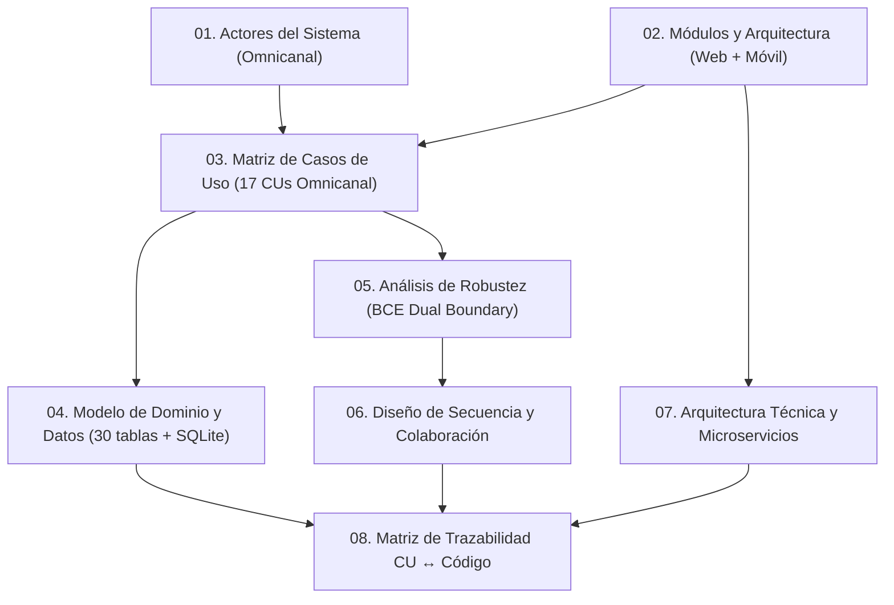

---
tags:
  - si2
  - parcial2
  - mirroria
  - tiendaria
  - iconix
  - uml
  - documentacion
  - indice
  - omnicanal
date: 2026-11-06
---

# 📚 Índice General de Documentación — Segundo Parcial SI2 (MirrorIA Omnicanal)

> [!NOTE] 📌 Ficha Académica e Institucional
> - **Materia:** Sistemas de Información II (SI2) — Semestre 2-2026.
> - **Proyecto:** **MirrorIA** — Plataforma SaaS Multi-tenant de Moda Femenina con Probador Virtual por IA, Pasarelas Enchufables, Operación Offline Omnicanal (**Web PWA + Móvil Expo/SQLite**), BI y Machine Learning.
> - **Tienda Demo Principal:** **Tiendaria** (slug `tiendaria`), boutique oficial con el catálogo y datos históricos del 1.er Ciclo.
> - **Metodología de Desarrollo:** **ICONIX Process** (Proceso ágil guiado por Casos de Uso: Modelo de Dominio $\to$ Casos de Uso $\to$ Diagramas de Robustez (*Boundary-Control-Entity*) $\to$ Diagramas de Secuencia $\to$ Clases de Diseño $\to$ Código Fuente).
> - **Estándar de Modelado:** **UML 2.5.1** (OMG - Object Management Group).
> - **Fecha Límite de Entrega:** Miércoles 11 de Noviembre de 2026, 08:00.

---

## 🗂️ Estructura de Documentación Técnica (ICONIX 2.º Ciclo)

La documentación se articula en capítulos secuenciales y trazables, integrando el soporte omnicanal (Web PWA + Móvil Expo):

### Capítulos de Requisitos y Fundamentos

| Archivo | Documento | Alcance y Contenido Clave |
|---|---|---|
| `01_Actores_del_Sistema.md` | [[U/2-2026/SI2/Parcial2/Documentacion/01_Actores_del_Sistema\|01. Actores del Sistema]] | Definición formal de los 6 actores humanos y 6 actores externos/sistemas, con su matriz de interacción omnicanal (Web Desktop/PWA y Móvil React Native/Expo). |
| `02_Modulos_y_Arquitectura.md` | [[U/2-2026/SI2/Parcial2/Documentacion/02_Modulos_y_Arquitectura\|02. Módulos y Arquitectura]] | Arquitectura de doble cliente (Web React 19 PWA + Móvil Expo SDK con SQLite embebido), 14 módulos de backend NestJS, microservicio ML (FastAPI :8002) y protocolo transaccional de idempotencia. |
| `03_Matriz_Casos_de_Uso.md` | [[U/2-2026/SI2/Parcial2/Documentacion/03_Matriz_Casos_de_Uso\|03. Matriz de Casos de Uso]] | Catálogo maestro de **17 Casos de Uso Omnicanal (CU01–CU17)** estructurados para defensa de examen. Integra el principio de *Dual Boundary* (frontera web vs frontera móvil) compartiendo la misma lógica de negocio, pasarelas y resolución de conflictos `stock = 1`. |

---

## 🧭 Resumen de Fases Técnicas Implementadas (Trazabilidad)

El sistema integra de forma verificada y automatizada las siguientes fases de desarrollo:

1. **Fase 1 — SaaS Multi-tenant:** Base de datos compartida con discriminador `tenant_id`, contexto por request (`X-Tenant`), aislamiento criptográfico y aprovisionamiento automático.
2. **Fase 1b — Personalización e Identidad Visual:** Motor de theming dinámico con validación estricta de contraste WCAG 2.1 ($\ge 4.5:1$), logos, fuentes y panel directivo del superusuario.
3. **Fase 2 — Pasarelas Enchufables:** Arquitectura desacoplada con registro central (`IPasarelaProveedor`), integración Stripe y Wayra QR (nacional), y cobro recurrente B2B de suscripciones SaaS.
4. **Fase 3 — Operación Offline, Omnicanalidad e Idempotencia:** Web PWA (Service Worker + IndexedDB) y Móvil (Expo + SQLite), cola outbox FIFO, tabla `idempotencia` en backend con SHA-256 y resolución determinista del conflicto de concurrencia `stock = 1` con transacción compensatoria.
5. **Fase 4 — Reportes Dinámicos y Exportación Excel:** Tabla pivote interactiva con repivoteo en vivo, constructor visual analítico y generación de libros `.xlsx` contables con `exceljs`.
6. **Fase 5 — Business Intelligence (BI) y Dashboards Diferenciados:** Consola ejecutiva gerencial para `ADMIN` y consola operativa POS de mostrador para `CAJERO`/`ENCARGADO`.
7. **Fase 6 — Machine Learning Operativo (FastAPI :8002):** 4 modelos Scikit-Learn atados a KPIs (Demanda Random Forest, No-Show Regresión Logística, Segmentación RFM K-Means y Detección de Anomalías Isolation Forest).
8. **Fase 6b — Rediseño UX/UI Gerencial:** Menú lateral en acordeón, humanización de reportes IA y dashboards en lenguaje directivo.
