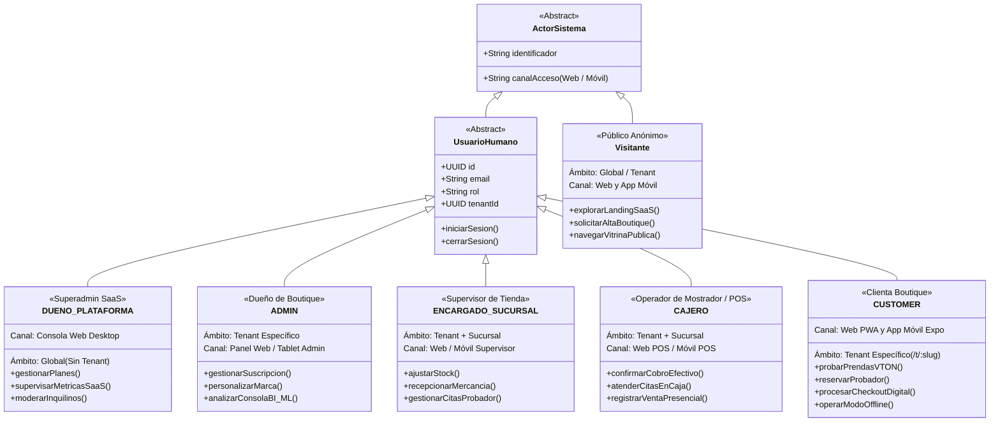

---
tags:
  - si2
  - parcial2
  - mirroria
  - iconix
  - uml
  - actores
  - requisitos
  - mobile
date: 2026-11-06
---

# 👥 01. Catálogo Formal de Actores del Sistema — MirrorIA (Omnicanal)

> [!NOTE] 📌 Metodología ICONIX y Enfoque Omnicanal
> En el marco de **ICONIX**, los actores representan los roles de interacción con el sistema. Para optimizar el diseño y evitar duplicaciones innecesarias, los actores operan a través de una **arquitectura omnicanal**, accediendo indistintamente vía **Cliente Web (PWA)** o **Cliente Móvil (React Native / Expo)** según el contexto de uso.

---

## 🏛️ 1. Taxonomía y Jerarquía de Actores (UML 2.5)

---

## 📋 2. Matriz de Atribuciones, Ámbitos y Canales de Acceso

| Actor | Rol en BD (`usuarios.rol`) | Ámbito Multi-Tenant | Canales de Acceso (Fronteras UI) | Responsabilidades y Atribuciones Principales |
|---|---|---|---|---|
| **Superadministrador de Plataforma** | `DUENO_PLATAFORMA` | **Global** (`tenant_id = NULL`). Prohibido operar datos de tiendas (`403`). | • Web Desktop (`/plataforma/*`) | • Parametriza planes comerciales (Básico, Crecimiento, Cadena) y sus límites. • Monitorea indicadores globales SaaS: MRR, ARR, Churn, GMV e inquilinos. • Modera tiendas: suspende inquilinos morosos y restablece identidades infractoras. • Administra el catálogo de ciudades capitales homologadas. |
| **Dueño de Boutique / Administrador** | `ADMIN` | **Inquilino** (`tenant_id` obligatorio). | • Web Desktop / Tablet (`/admin/*`) | • Contrata y renueva la suscripción B2B de su boutique (Stripe / Wayra QR). • Configura la identidad corporativa: paleta de colores (validación WCAG 2.1), tipografía, logo y modo de tienda. • Administra sucursales físicas, catálogo maestro y personal operativo. • Analiza métricas en la Consola Ejecutiva de BI y toma decisiones con soporte de Machine Learning y reportes dinámicos. |
| **Encargado de Sucursal** | `ENCARGADO_SUCURSAL` | **Inquilino + Sucursal** (`sucursal_id` forzado en JWT). | • Web Admin (`/admin/*`) • App Móvil (Gestión Tienda) | • Supervisa existencias y kardex inmutable de su tienda asignada. • Recepciona pedidos de confeccionistas, incrementando el stock disponible. • Realiza ajustes manuales justificados de inventario ante mermas. • Controla el avance de las citas de probador (`CONFIRMADA`, `EN_TIENDA`). |
| **Cajero / Operador POS** | `CAJERO` | **Inquilino + Sucursal** (`sucursal_id` forzado en JWT). | • Web POS (`/admin/dashboard`) • App Móvil POS | • Atiende en mostrador físico. • Consulta la agenda de citas del día en la Consola Operativa y atiende clientas con un solo clic. • Confirma el cobro en efectivo de ventas y reservas. • Registra compras presenciales de mostrador con descuento atómico de stock. |
| **Clienta Digital** | `CUSTOMER` | **Inquilino** (`/t/:slug`). | • Web PWA (`/t/:slug/*`) • App Móvil (Expo Storefront) | • Explora vitrinas digitales con la marca de la tienda elegida. • Usa el Probador Virtual con IA generativa (Decart `lucy-vton-3.5`). • Aparta reservas de prendas para prueba presencial sin pago previo. • Gestiona su carrito, aplica cupones y procesa pagos (Stripe / QR Wayra). • **Modo Offline:** Mantiene operatividad desconectada con sincronización diferida (IndexedDB en Web, SQLite en Móvil) e idempotencia. |
| **Visitante / Usuario Anónimo** | *No autenticado* (`ANONYMOUS`) | **Público** (Sin sesión activa). | • Web Landing (`/`, `/planes`) • App Móvil Pública | • Evalúa la propuesta de valor SaaS y compara planes. • Solicita el alta automatizada de su boutique (`/registro-tienda`). • Navega vitrinas públicas y consulta disponibilidad de stock por sucursal. |

---

## 🤖 3. Actores de Sistema y Servicios Externos

| Actor Externo | Naturaleza | Canal / Punto de Contacto | Garantía Transaccional |
|---|---|---|---|
| **Stripe Gateway** | Pasarela SaaS Internacional | `POST /pagos/ventas/:id/sesion`, Webhook `/pagos/webhook` | Sesión alojada y verificación de firma criptográfica `Stripe-Signature`. |
| **Banco Simulado Wayra** | Servicio Financiero QR Nacional | `POST /wayra/cobros/:token/pagar`, Callback `/pagos/qr/aviso` | Mensajes firmados con HMAC-SHA256 e idempotencia por `event_id`. |
| **Decart AI Engine** | Motor VTON en la Nube | `POST /probador/token` | Generación de credencial efímera (token temporal de 5 minutos). |
| **Microservicio ML (:8002)** | Contenedor Python FastAPI | Endpoints internos `/ml/*` | Modelos entrenados (`seed=42`, $N=10.000$) con fallback heurístico resiliente. |
| **DeepSeek LLM** | Motor de Lenguaje Natural | Consumido por módulo `ia` | Mapeo a catálogo de 23 métricas parametrizadas (nunca genera SQL directo). |
| **Worker Scheduler (Cron)** | Tarea Programada Background (5 min) | `POST /pagos/expirar-vencidas` | Expiración periódica de pagos vencidos, carritos caducos y reservas `NO_SHOW`. |
