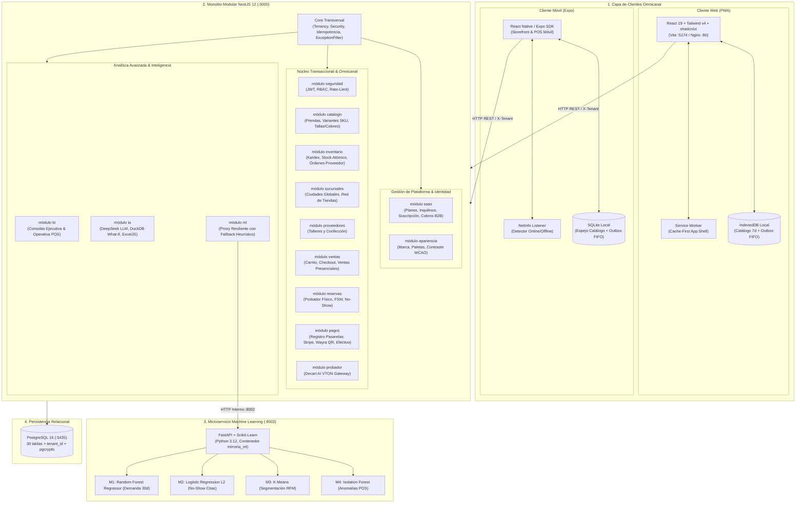
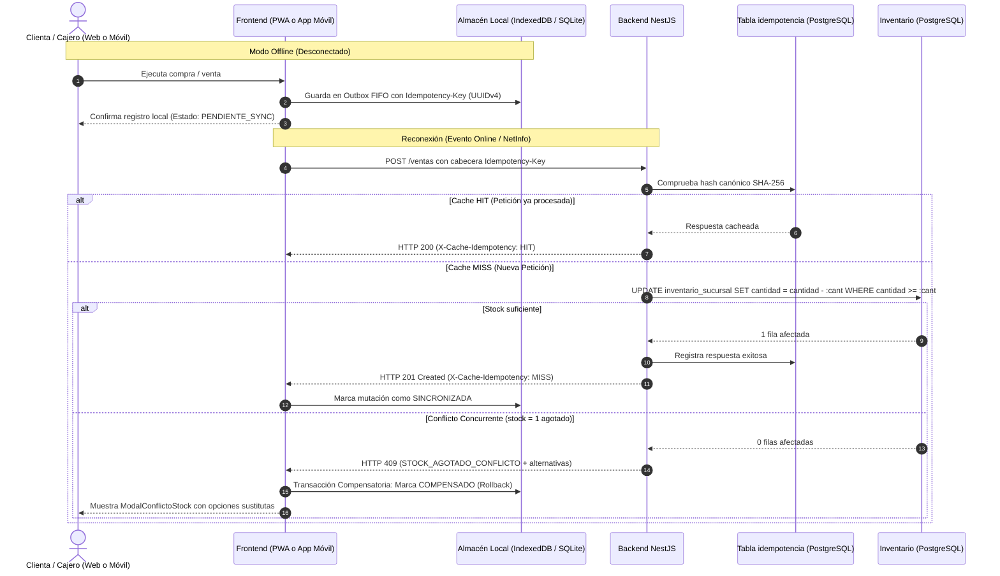

---
tags:
  - si2
  - parcial2
  - mirroria
  - arquitectura
  - modulos
  - uml
  - iconix
  - mobile
  - pwa
date: 2026-11-06
---

# 🏗️ 02. Desglose Modular y Arquitectura del Sistema — MirrorIA (Omnicanal)

> [!NOTE] 📌 Principio Arquitectónico Rector: Omnicanalidad y Desacoplamiento
> MirrorIA está estructurado como un **Monolito Modular de Alta Cohesión y Bajo Acoplamiento** con soporte **Omnicanal**:
> 1. **Capa Cliente Dual:** Web Progresiva (**React 19 + PWA**) y Aplicación Móvil nativa (**React Native / Expo + SQLite**), ambas consumiendo la misma API y compartiendo los mismos modelos de negocio.
> 2. **Microservicio Autónomo de Machine Learning:** En Python 3.12 + FastAPI (:8002) para inferencia analítica.
> 3. **API Central NestJS 12 (:3000):** 14 módulos de negocio, persistencia relacional en PostgreSQL 16 con aislamiento multi-tenant y resiliencia transaccional.

---

## 🏛️ 1. Diagrama de Arquitectura de Capas y Clientes Omnicanal (UML 2.5)

El sistema soporta una arquitectura de doble cliente (Web PWA y Móvil) desacoplada del backend:

---

## 📱 2. Especificación del Soporte Móvil (React Native / Expo + SQLite)

En el marco metodológico de ICONIX, el soporte móvil se modela como un **canal cliente alternativo** que comparte el 100% de los controladores y entidades del backend:

| Dimensión Técnica | Cliente Web (PWA) | Cliente Móvil (Expo / React Native) |
|---|---|---|
| **Tecnología Base** | React 19 + Vite + Tailwind v4 + shadcn/ui | React Native + Expo SDK + Expo Router |
| **Detección de Red** | Eventos nativos `window.addEventListener('online'/'offline')` | Hook `@react-native-community/netinfo` |
| **Persistencia Local Desconectada** | `IndexedDB` (Almacenes `catalogo_cache` y `outbox`) | `expo-sqlite` (Base relacional embebida `mirroria_local.db`) |
| **Tiempo de Vida de Caché (TTL)** | 7 días con invalidación por versión | 7 días con recarga diferencial |
| **Protocolo de Cola Outbox** | Cola FIFO procesada en background al reconectar | Cola FIFO SQLite procesada automáticamente ante evento `isConnected` |
| **Garantía Transaccional** | Cabecera `Idempotency-Key` (UUIDv4) con hash SHA-256 | Cabecera `Idempotency-Key` (UUIDv4) con hash SHA-256 |
| **Resolución de Conflicto `stock = 1`** | `ModalConflictoStock` con alternativas guiadas | `ModalConflictoStock` nativo con alternativas guiadas |

---

## 📦 3. Catálogo de los 14 Módulos del Backend (NestJS 12)

| # | Módulo | Tablas de Base de Datos Asociadas | Responsabilidad y Lógica Encapsulada |
|---|---|---|---|
| **01** | `saas` | `planes`, `inquilinos`, `suscripciones`, `inquilino_marca`, `eventos_plataforma`, `cobros_suscripcion` | Aprovisionamiento automatizado de workspace. Planes comerciales, límites por tienda, suscripción B2B (Stripe/Wayra), personalización y panel directivo. |
| **02** | `seguridad` | `usuarios`, `refresh_tokens` | Registro aislado por tienda (`X-Tenant`), autenticación JWT (1 h, revalidado en BD), RBAC, staff acotado a sucursal y rate-limit por IP. |
| **03** | `catalogo` | `categorias`, `temporadas`, `colecciones`, `tallas`, `colores`, `productos`, `variantes_producto` | Taxonomía femenina. Variantes SKU por talla/color con `precioCents`. Control de tope de prendas del plan SaaS al crear o reactivar productos. |
| **04** | `proveedores` | `proveedores` | Registro de talleres de confección y proveedores textiles. En el alta de tienda crea automáticamente "Producción propia". |
| **05** | `sucursales` | `ciudades` (global), `sucursales` | Ciudades capitales (globales) y sucursales físicas por tienda con validación de cuotas del plan. |
| **06** | `inventario` | `inventario_sucursal`, `movimientos_inventario`, `ordenes_compra` | Existencias (`disponible`, `reservado`, `transito`) con `UPDATE` condicionado. Órdenes a talleres con recepción parcial/total y kardex inmutable. |
| **07** | `ventas` | `carritos` (jsonb), `ventas`, `venta_items` | Carrito persistente, checkout digital (`PENDIENTE`), ventas presenciales POS (`PAGADA`), comprobantes `C-XXXXXXXX` y cancelación con rollback. |
| **08** | `reservas` | `reservas`, `reserva_items` | Apartado de hasta 3 prendas para probador físico en sucursal (máx 2 citas). Máquina de estados finitos y sanción de 30 días ante 2 inasistencias (`NO_SHOW`). |
| **09** | `promociones` | `cupones` | Cupones porcentuales o monto fijo con compra mínima y límite de usos. Validación protegida contra fuerza bruta (30 peticiones/5 min). |
| **10** | `pagos` | `pagos` | **Registro Central de Pasarelas (`IPasarelaProveedor`)**: Stripe (sesión alojada y webhook), Wayra QR (HMAC-SHA256) y efectivo. Barrida periódica de impagas. |
| **11** | `probador` | *(Sin tablas; consume Decart AI)* | Gateway hacia Decart (`lucy-vton-3.5`). Tokens efímeros de 5 min (10 peticiones/10 min por IP). |
| **12** | `bi` | *(Consultas SQL analíticas en tiempo real)* | **Consola Ejecutiva:** Ingresos con deltas simétricos, rotación, conversión probador $\to$ venta, Recharts y uso de plan. **Consola Operativa POS:** Corte diario local `America/La_Paz`, alertas de stock crítico $\le 2$ u. y agenda con atención en 1 clic. |
| **13** | `ia` | `interacciones_ia` | Reportes por lenguaje natural (23 métricas parametrizadas, sin SQL directo generado por LLM), agente What-If en DuckDB `:memory:` y exportación Excel (.xlsx) contable con `exceljs`. |
| **14** | `ml` | *(Proxy HTTP hacia microservicio :8002)* | Proxy multi-tenant hacia `mirroria-ml` con **fallback heurístico resiliente** (`X-ML-Fallback: true`). |

---

## 🧠 4. Microservicio de Machine Learning (`mirroria-ml` :8002)

FastAPI + Scikit-Learn sobre dataset calibrado ($N=10.000$, `seed=42`, RAM $\approx 68$ MB):
1. **M1 — Demanda a 30 Días (Supervisado - Regresión):** `RandomForestRegressor` ($R^2=0.9566$, MAE 1.91) $\to$ Evita quiebres de percha.
2. **M2 — Inasistencia No-Show (Supervisado - Clasificación):** `LogisticRegression` L2 (ROC-AUC 0.7978, $F_1=0.7440$) $\to$ Semáforo de citas en probador.
3. **M3 — Segmentación RFM (No Supervisado - Clustering):** `KMeans(K=4)` (Silueta 0.6823) $\to$ Clústeres de clientas para fidelización.
4. **M4 — Detección de Anomalías POS (No Supervisado - Outliers):** `IsolationForest` (contaminación 0.03) $\to$ Auditoría de fraude y descuadres en caja.

---

## 📶 5. Resiliencia Transaccional: Protocolo de Idempotencia y Conflicto `stock = 1`

Tanto el cliente **Web (PWA)** como el cliente **Móvil (Expo)** comparten el mismo protocolo transaccional ante caídas de red:

