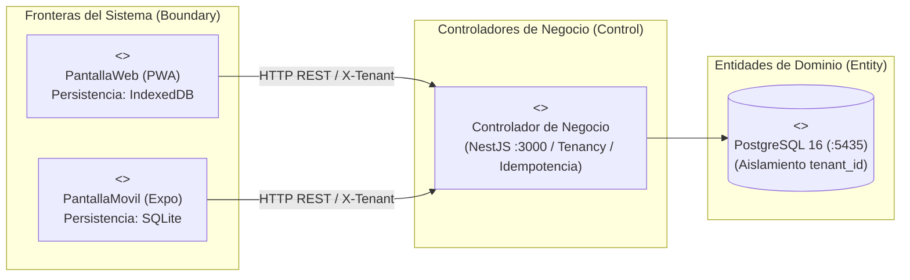

---
tags:
  - si2
  - parcial2
  - mirroria
  - casos_de_uso
  - iconix
  - uml
  - examen_si2
  - mobile
  - omnicanal
date: 2026-11-06
---

# 📋 03. Matriz Consolidada de Casos de Uso — MirrorIA (17 CUs Omnicanal)

> [!IMPORTANT] 🎯 Principio de Omnicanalidad en ICONIX (Web + Móvil)
> En la metodología **ICONIX**, un Caso de Uso modela la **intención de negocio del usuario** (ej. comprar prendas, reservar probador, sincronizar transacciones offline), la cual es independiente del dispositivo.
> - **Fronteras Duales (Boundary):** Cada caso de uso del cliente o de mostrador cuenta con dos objetos de frontera: `<<Boundary>> PantallaWeb...` (React 19 / PWA) y `<<Boundary>> PantallaMovil...` (React Native / Expo).
> - **Control y Entidad Únicos:** Ambos canales consumen los mismos controladores en NestJS (`<<Control>>`) y operan sobre las mismas entidades de PostgreSQL (`<<Entity>>`).
> - **Persistencia Offline Diferencial:** La Web persiste en **IndexedDB**, mientras que el Móvil persiste en su base de datos local embebida **SQLite** (`expo-sqlite`). Ambos sincronizan mediante la misma cabecera `Idempotency-Key`.

---

## 🗺️ 1. Modelo de Frontera Dual en Robustez (BCE Omnicanal)

---

## 📋 2. Matriz Maestra de Casos de Uso (17 CUs Omnicanal)

| # | Área de Examen | CU | Nombre del Caso de Uso | Canal / Frontera | Actores Primarios y Secundarios | Pantalla / Ruta UI | Endpoints Backend | Operaciones Agrupadas y Punto Fuerte de Examen |
|---|---|---|---|---|---|---|---|---|
| **01** | **SaaS Multi-tenant** | **CU01** | Aprovisionar Tienda y Workspace SaaS | **Web** | • **Visitante / Dueño** • Stripe / Wayra | `/planes` `/registro-tienda` | `POST /saas/tiendas` `GET /saas/tiendas/disponibilidad` | **Aprovisionamiento atómico:** Selección de plan, registro de boutique, creación de BD con `tenant_id`, sucursal física matriz, usuario `ADMIN`, proveedor y catálogo demo en una sola transacción. Período `TRIAL` (14 días). |
| **02** | **SaaS Multi-tenant** | **CU02** | Administrar Suscripciones, Planes y Moderación | **Web** | • **Superadmin** (`DUENO_PLATAFORMA`) • **Dueño Tienda** (`ADMIN`) | `/plataforma/*` `/admin/suscripcion` | `GET/PATCH /saas/plataforma/*` `GET/POST /saas/mi-suscripcion/*` | **Gobierno B2B:** Superadmin parametriza límites de planes (sucursales, prendas, staff), monitorea métricas SaaS (MRR, Churn, GMV) y suspende tiendas. Dueño consulta cuotas (`UsoPlanService`) y paga/renueva suscripción. |
| **03** | **Personalización** | **CU03** | Personalizar Identidad Visual de Boutique | **Web** | • **Dueño Tienda** (`ADMIN`) • Superadmin (de oficio) | `/admin/apariencia` `/plataforma/inquilinos/:id` | `GET/PUT /saas/mi-marca` `POST /mi-marca/restablecer` | **Theming dinámico y accesibilidad:** Configuración de logo, tipografías, banners y colores de marca con validación matemática obligatoria de contraste **WCAG 2.1** (ratio $\ge 4.5:1$). Restablecimiento a paleta sugerida. |
| **04** | **Catálogo Maestro** | **CU04** | Gestionar Catálogo Maestro y Variantes SKU | **Web** | • **Dueño Tienda** (`ADMIN`) | `/admin/catalogo/*` | `CRUD /catalogo/productos` `CRUD /variantes`, `/categorias` | **Taxonomía exclusiva femenina:** Categorías, temporadas, colecciones, tallas y colores HEX. Publicación de prendas maestras con imágenes `jsonb` y variantes SKU con precio en centavos, respetando el límite del plan. |
| **05** | **Logística & Red** | **CU05** | Gestionar Inventario, Sucursales y Abastecimiento | **Web / Móvil** (Supervisor) | • **Dueño Tienda** (`ADMIN`) • **Encargado** (`ENCARGADO_SUCURSAL`) | `/admin/inventario` `/admin/sucursales` `/admin/proveedores` | `CRUD /sucursales` `POST /inventario/ordenes-compra` `POST /inventario/recepciones` `POST /inventario/ajuste` | **Control físico y kardex:** Red de tiendas por ciudad, asignación de personal, órdenes de compra a confeccionistas, recepción parcial/total en tienda incrementando stock libre (`UPDATE` condicionado) y kardex inmutable. |
| **06** | **Experiencia Retail** | **CU06** | Explorar Vitrina y Probar Prendas con IA (VTON) | **Omnicanal** (Web PWA & App Móvil) | • **Clienta** (`CUSTOMER`) • Visitante • Decart AI Engine | `/t/:slug` `/t/:slug/tienda` `/t/:slug/probador/:id` | `GET /catalogo/productos` `GET /inventario/.../disponibilidad` `POST /probador/token` | **Probador virtual generativo:** Vitrina adaptada a la marca de la tienda, desglose de stock por sucursal e integración con Decart AI (`lucy-vton-3.5`) mediante token efímero de 5 min (10 peticiones/10 min por IP). |
| **07** | **Ventas & Checkout** | **CU07** | Gestionar Carrito y Procesar Checkout Digital | **Omnicanal** (Web PWA & App Móvil) | • **Clienta** (`CUSTOMER`) | `/t/:slug/carrito` `/t/:slug/checkout` `/t/:slug/mis-pedidos` | `GET/POST /ventas/carrito` `POST /promociones/cupones/validar` `POST /ventas/checkout` `GET /ventas/mias` | **Conversión omnicanal:** Carrito persistente (`jsonb` / SQLite local), validación de cupones, descuento atómico de stock y creación de venta en estado `PENDIENTE` (máx 2 compras pendientes por usuaria). |
| **08** | **Pasarelas Enchufables** | **CU08** | Procesar Cobros con Pasarelas Enchufables | **Omnicanal** (Web PWA & App Móvil) | • **Clienta** (`CUSTOMER`) • **Cajero** (`CAJERO`) • Stripe / Wayra QR | `/t/:slug/pago/:id` `/wayra/pagar/:token` `/admin/cobros` | `POST /pagos/ventas/:id/sesion` `POST /pagos/ventas/:id/qr` `POST /pagos/:id/confirmar` `POST /pagos/webhook`, `/aviso` | **Arquitectura desacoplada:** Registro central `RegistroPasarelasService` (`IPasarelaProveedor`), Stripe con sesión alojada y webhook firmado, Wayra QR con HMAC-SHA256, confirmación manual en efectivo y barrida de impagas. |
| **09** | **Probador Físico** | **CU09** | Gestionar Reservas para Probador Físico | **Omnicanal** (Web PWA & App Móvil) | • **Clienta** (`CUSTOMER`) • **Encargado / Cajero** | `/t/:slug/reservas` `/admin/reservas` `/admin/dashboard` | `POST /reservas` `PATCH /reservas/:id/estado` `POST /ventas/presenciales` | **Flujo anti-acaparamiento:** Apartado de hasta 3 prendas (máx 2 citas), bloqueo en `cantidad_reservada` (hasta 50% de stock libre), máquina de estados (`EN_TIENDA` en 1 clic en caja) y bloqueo de 30 días ante 2 inasistencias (`NO_SHOW`). |
| **10** | **Offline & Resiliencia** | **CU10** | Operar en Modo Desconectado con Sincronización Segura | **Omnicanal** (Web PWA & App Móvil) | • **Clienta / Cajero** • Service Worker / SQLite | `/t/:slug` (PWA / Móvil) `/admin/dashboard` | *Service Worker + IndexedDB* *NetInfo + SQLite Local* Interceptor `Idempotency-Key` | **Punto de examen:** • **Web:** Almacena en `IndexedDB` (7d TTL) y encola en Outbox FIFO. • **Móvil:** Almacena en espejo local `SQLite` y encola en Outbox FIFO. • **Ambos:** Al reconectar, envían la misma cabecera `Idempotency-Key` (SHA-256) garantizando cero duplicados. |
| **11** | **Concurrencia Crítica** | **CU11** | Resolver Conflicto de Concurrencia de Stock (`stock = 1`) | **Omnicanal** (Web PWA & App Móvil) | • **Clienta / Cajero** • API Backend | `ModalConflictoStock` (Web y Nativo Móvil) | `POST /ventas/checkout` (Respuesta HTTP 409 tipada) | **Pregunta clave de examen:** El servidor es autoridad única ante colisión offline por la última prenda. Si falla el UPDATE condicionado, devuelve 409 `STOCK_AGOTADO_CONFLICTO`; tanto la PWA como la App Móvil ejecutan **transacción compensatoria** (rollback local en outbox) y sugieren sustitutos guiados. |
| **12** | **Business Intelligence** | **CU12** | Monitorear Consola Ejecutiva de Negocio (ADMIN) | **Web / Tablet** | • **Dueño Tienda** (`ADMIN`) • Encargado | `/admin/dashboard` (Consola Ejecutiva) | `GET /dashboard/ejecutivo` | **Toma de decisiones directivas:** Facturación neta con deltas simétricos, ticket promedio, rotación de percha (`ventas / stock`), conversión probador $\to$ venta, pasarelas, top prendas inmunes a fan-out y cuotas del plan. |
| **13** | **Business Intelligence** | **CU13** | Operar Consola de Mostrador POS del Día (Cajero) | **Omnicanal** (Web POS & Móvil POS) | • **Cajero** (`CAJERO`) • Encargado | `/admin/dashboard` (Consola Operativa) | `GET /dashboard/operativo` | **Agilidad táctica en mostrador:** Ventas en efectivo del turno con corte en `America/La_Paz`, alertas de stock crítico ($\le 2$ u.) o agotado, y agenda de citas del día con recepción en tienda en un solo clic. |
| **14** | **Analítica Avanzada** | **CU14** | Consultar Analítica en Lenguaje Natural e Híbrido con IA | **Web** | • **Dueño Tienda** (`ADMIN`) • Encargado • DeepSeek LLM | `/admin/reportes` (Chat Inteligente) | `POST /ia/reportes` `POST /ia/reportes/hibrido` | **IA segura y explicable:** El LLM mapea preguntas abiertas (texto/voz) a un catálogo de 23 métricas parametrizadas (nunca escribe SQL directo), corre simulaciones *What-If* en DuckDB in-process (`:memory:`) y narra conclusiones gerenciales. |
| **15** | **Analítica Avanzada** | **CU15** | Construir Reportes Dinámicos y Exportar a Excel | **Web** | • **Dueño Tienda** (`ADMIN`) • Encargado | `/admin/reportes` (Lienzo & Constructor) | `POST /ia/reportes/consulta` `POST /ia/reportes/exportar-excel` | **Reportería interactiva corporativa:** Constructor visual de consultas sin coste de tokens de LLM, repivoteo en vivo por dimensiones cruzadas y generación nativa de libros contables `.xlsx` (`exceljs`) con formato `"Bs" #,##0.00` y fórmulas GAAP. |
| **16** | **Machine Learning** | **CU16** | Predecir Demanda de Inventario y Riesgo de Citas (Modelos Supervisados) | **Web / Móvil** | • **Dueño Tienda** (`ADMIN`) • Encargado / Cajero • Microservicio ML | `/admin/ml` (Demanda) `/admin/dashboard` (POS) | `GET /ml/kpis/demanda` `GET /ml/kpis/no-show` | **Inferencia supervisada (:8002):** • **M1:** `RandomForestRegressor` ($R^2 = 0.9566$, MAE 1.91) para demanda a 30 días $\to$ previene quiebres de stock. • **M2:** `LogisticRegression` L2 (ROC-AUC 0.7978, $F_1 = 0.7440$) para probabilidad de No-Show $\to$ semáforo de asistencia en citas. |
| **17** | **Machine Learning** | **CU17** | Auditar Anomalías POS y Segmentar Clientes (Modelos No Supervisados) | **Web** | • **Dueño Tienda** (`ADMIN`) • Microservicio ML | `/admin/ml` (Clientas) `/admin/ml` (Caja POS) Modal Metodología | `GET /ml/kpis/rfm` `GET /ml/kpis/anomalias` `GET /ml/modelos/metricas` | **Inferencia no supervisada (:8002):** • **M3:** `KMeans` ($K=4$, Silueta 0.6823) sobre variables RFM $\to$ fidelización de clientas. • **M4:** `IsolationForest` (contaminación 0.03) $\to$ detección de fraudes y descuadres en caja POS. • Ficha formal con dataset sintético reproducible ($N=10.000$, `seed=42`). |

---

## 🎯 3. Justificación Académica para la Defensa (Preguntas Típicas de Examen)

1. **¿Por qué un enfoque Omnicanal (Web + Móvil) en lugar de crear CUs separados?**
   En metodología ICONIX, el caso de uso captura la meta esencial del usuario (*Essential Use Case*). Comprar, apartar una reserva o pagar son la misma meta de negocio; duplicarlos solo porque la UI cambia de React a React Native generaría redundancia estéril en diagramas de robustez y secuencia.
2. **¿Dónde se refleja el soporte Móvil en ICONIX?**
   - En el **Diagrama de Robustez (BCE):** Mediante dos objetos *Boundary* (`PantallaWeb` y `PantallaMovil`) conectados al mismo objeto *Control* (API NestJS) y las mismas *Entity* (PostgreSQL).
   - En los **Mecanismos de Persistencia Offline:** En Web se utiliza `IndexedDB` coordinado por el Service Worker; en Móvil se utiliza base de datos local embebida `SQLite` (`expo-sqlite`).
3. **¿Cómo se resuelve la colisión offline `stock = 1` entre Web y Móvil?**
   Si una clienta en la app móvil y otra en la web compran la última unidad estando sin conexión, al reconectar ambas envían su orden con `Idempotency-Key`. El backend ejecuta un `UPDATE` condicionado atómico; la primera transacción descuenta el stock y la segunda recibe `HTTP 409 STOCK_AGOTADO_CONFLICTO`. Tanto la PWA como la App Móvil activan automáticamente una **transacción compensatoria** (rollback local en outbox) y despliegan el modal interactivo con opciones guiadas de sustitución.
