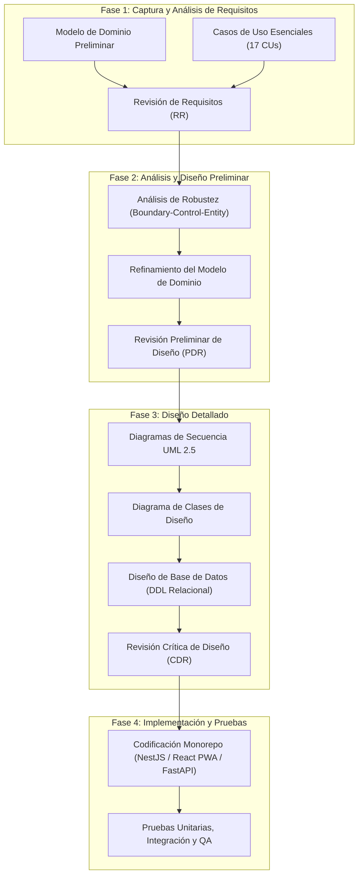

---
tags:
  - si2
  - parcial2
  - mirroria
  - aspectos_generales
  - iconix
  - capitulo1
date: 2026-11-06
---

# CAPÍTULO I. ASPECTOS GENERALES

---

## 1.1. Introducción

En la actualidad, la industria del comercio minorista y, de manera particular, el sector de la moda femenina (*fashion retail*), experimenta una acelerada transformación impulsada por la digitalización de los canales de venta, la exigencia de experiencias omnicanal fluidas y la necesidad de optimizar la gestión operativa en tiempo real. La convergencia entre el comercio electrónico tradicional y los puntos de venta físicos (POS) demanda plataformas capaces de garantizar disponibilidad continua, fidelidad estética de marca y personalización avanzada.

Durante la primera etapa de desarrollo (Primer Parcial de Sistemas de Información II), se diseñó e implementó la línea base funcional de la plataforma de comercio electrónico denominada **MirrorIA**, orientada inicialmente a resolver los desafíos comerciales, de inventario y de atención en probador para una tienda física multi-sucursal de moda femenina (hoy preservada como la tienda oficial demo **Tiendaria**, con slug `tiendaria`). Dicha solución inicial integró la administración de catálogos multivariante (categorías, temporadas, colecciones, tallas y colores HEX con variantes SKU), control de existencias con actualización condicional atómica, reservas de prendas para prueba presencial en tienda con reglas anti-acaparamiento, registro de compras presenciales de mostrador y un probador virtual interactivo basado en inteligencia artificial generativa con Decart (`lucy-vton-3.5`).

No obstante, las dinámicas del mercado del software contemporáneo y las exigencias de escalabilidad empresarial demandan una evolución estructural del sistema: la transición desde una aplicación monotienda hacia una **plataforma SaaS (*Software as a Service*) Multi-tenant**. Bajo este nuevo paradigma, múltiples boutiques de moda independientes pueden registrarse, aprovisionar su propio espacio de trabajo (*workspace*) en cuestión de segundos, personalizar integralmente su identidad visual corporativa conforme a estándares de accesibilidad internacional, operar de manera aislada y segura sobre una base de datos relacional compartida, y gestionar sus cobranzas tanto digitales (Stripe y QR interoperable) como físicas.

Asimismo, ante la realidad de la infraestructura de telecomunicaciones en Bolivia y la región, donde la conectividad a Internet en tiendas físicas y centros comerciales presenta intermitencias o cortes imprevistos, se vuelve imperativo dotar a la plataforma de capacidades **Offline-First**. Esto permite que tanto las clientas como el personal de caja continúen navegando catálogos y procesando transacciones sin conexión desde aplicaciones web progresivas (PWA) y dispositivos móviles nativos, garantizando sincronización idempotente y libre de sobreventas al restablecer la red. Finalmente, la incorporación de consolas diferenciadas de Inteligencia de Negocios (BI) y modelos de Machine Learning desacoplados atados a Indicadores Clave de Desempeño (KPIs) completa la transformación de MirrorIA en una solución de vanguardia tecnológica para el sector textil.

---

## 1.2. Planteamiento del Problema

El sector minorista de indumentaria femenina en Bolivia enfrenta diversas barreras tecnológicas y operativas que limitan su competitividad frente a grandes cadenas internacionales:

1. **Altos costos y complejidad de digitalización:** Pequeñas y medianas boutiques carecen de capital para desarrollar plataformas de comercio electrónico propias con probadores virtuales y analítica avanzada. Al recurrir a soluciones genéricas, pierden su identidad visual de marca o sufren limitaciones para gestionar sucursales físicas distribuidas.
2. **Vulnerabilidad operativa por dependencia de conectividad:** La mayoría de los sistemas de punto de venta (POS) y tiendas web dependen de una conexión a Internet permanente e ininterrumpida. Cuando la red cae en el mostrador físico, se detiene la facturación, se pierde la visibilidad de existencias y se generan colisiones de inventario o doble facturación al intentar cobrar manualmente.
3. **Pérdida de ventas por incertidumbre en tallas y acaparamiento:** El comercio electrónico de moda sufre tasas de devolución de hasta el 30% debido a que las compradoras no pueden visualizar cómo luce la prenda en su propio cuerpo. A su vez, los sistemas tradicionales de reserva permiten que clientas aparten prendas indefinidamente sin presentarse a la tienda, inmovilizando inventario valioso (*no-show*).
4. **Falta de herramientas analíticas accesibles para gerentes no técnicos:** Los dueños de boutiques suelen tomar decisiones de abastecimiento y pedidos a talleres de confección por intuición, careciendo de pronósticos matemáticos de demanda a 30 días, segmentación conductual de clientas o alertas tempranas de descuadres transaccionales en caja.

Ante esta problemática, surge la interrogante central de ingeniería: **¿Cómo estructurar y desarrollar una plataforma SaaS multi-tenant omnicanal para el sector de la moda femenina que garantice aislamiento de datos, resiliencia transaccional offline-first, personalización estética accesible, probador virtual generativo y analítica predictiva mediante Machine Learning?**

---

## 1.3. Objetivos del Proyecto

### 1.3.1. Objetivo General
Desarrollar e implementar **MirrorIA**, una plataforma de comercio electrónico bajo el modelo **SaaS Multi-tenant** para el sector de moda femenina, aplicando la metodología **ICONIX** y estándares **UML 2.5.1**, que integre capacidades de operación **Offline-First** (PWA y móvil con persistencia local e idempotencia), pasarelas de pago enchufables (Stripe y Wayra QR), probador virtual con inteligencia artificial generativa, consolas de Business Intelligence (BI) por rol y modelos de Machine Learning orientados a optimizar la toma de decisiones comerciales y logísticas.

### 1.3.2. Objetivos Específicos
1. **Modelar e implementar la arquitectura SaaS Multi-tenant:** Diseñar una base de datos relacional compartida en PostgreSQL con discriminador `tenant_id` en las tablas de negocio, reforzada mediante políticas de contexto por request (`X-Tenant`), que garantice el aprovisionamiento automatizado de tiendas y el aislamiento lógico absoluto entre inquilinos.
2. **Desarrollar el subsistema de personalización de identidad de marca:** Construir un motor de theming dinámico basado en tokens de diseño que permita a cada boutique parametrizar logotipos, tipografías, modos visuales (`CLARO`/`OSCURO`) y paletas cromáticas validadas matemáticamente bajo el estándar de accesibilidad **WCAG 2.1** (ratio de contraste $\ge 4.5:1$).
3. **Construir el núcleo de catálogo multivariante y gestión de inventario condicionado:** Implementar la administración jerárquica de categorías, temporadas, colecciones, prendas maestras y variantes SKU por talla/color con precio en centavos, asegurando rebajas atómicas de stock libre mediante sentencias `UPDATE` condicionadas para evitar cantidades negativas.
4. **Implementar el flujo omnicanal de reservas físicas con reglas anti-acaparamiento:** Diseñar una máquina de estados finitos (`PENDIENTE` $\to$ `CONFIRMADA` $\to$ `EN_TIENDA` $\to$ `COMPLETADA` / `NO_SHOW`) que bloquee stock en `cantidad_reservada` (hasta máx. 50% de existencias libres) y aplique penalizaciones automáticas de 30 días a clientas con inasistencias reiteradas.
5. **Integrar el probador virtual con inteligencia artificial generativa:** Conectar el sistema con el motor Decart (`lucy-vton-3.5`) para la síntesis de video/imagen en tiempo real de prendas sobre la imagen de la usuaria, mediante la generación de credenciales efímeras seguras de 5 minutos y control de tasa por IP.
6. **Diseñar una arquitectura de pasarelas de pago enchufables:** Implementar el registro centralizado `RegistroPasarelasService` bajo la interfaz `IPasarelaProveedor`, soportando pagos internacionales con **PayPal** (Orders v2: la orden se captura en el servidor al volver la clienta) y con tarjeta (Stripe Checkout con webhooks firmados), pagos nacionales con QR (Wayra, un banco **simulado** con avisos autenticados por HMAC-SHA256, elegido porque la API de un banco boliviano real no es accesible para este proyecto académico) y cobro manual en efectivo en mostrador.
7. **Desarrollar la resiliencia transaccional Offline-First e idempotencia:** Configurar un Service Worker con cache App Shell e IndexedDB (TTL 7 días) en la PWA web, y diseñar el almacenamiento local embebido en SQLite para la aplicación móvil nativa (Expo), incorporando colas de salida (*outbox*) FIFO y la cabecera `Idempotency-Key` (UUIDv4 con hash SHA-256 canónico) con resolución determinista del conflicto `stock = 1` mediante transacciones compensatorias.
8. **Diseñar consolas diferenciadas de Inteligencia de Negocios (BI):** Construir el Dashboard Ejecutivo para el rol `ADMIN` (ingresos con deltas simétricos, rotación de percha, tasa de conversión probador a venta, cuota de pasarelas y consumo de cuotas del plan SaaS) y el Dashboard Operativo POS para `CAJERO`/`ENCARGADO` (corte diario local en `America/La_Paz`, alertas de stock crítico $\le 2$ u. y agenda cronológica de citas con atención en 1 clic).
9. **Implementar el motor de reportes dinámicos con IA y exportación contable a Excel:** Desarrollar un agente conversacional basado en DeepSeek LLM que mapee lenguaje natural (texto o voz) a un catálogo formal de 23 métricas parametrizadas (sin generar SQL directo), permita simulaciones *What-If* en memoria con DuckDB y genere libros corporativos `.xlsx` con formato contable `"Bs" #,##0.00` y fórmulas de totales mediante `exceljs`.
10. **Desplegar un microservicio autónomo de Machine Learning orientado a KPIs:** Construir un servicio desacoplado en Python FastAPI (puerto `8002`, contenedor `mirroria_ml`) con 4 modelos estadísticos reproducibles ($N=10.000$, `seed=42`): Random Forest para predicción de demanda a 30 días, Regresión Logística L2 para riesgo de No-Show, K-Means para segmentación RFM e Isolation Forest para auditoría de anomalías en caja POS, enlazado al backend NestJS mediante un proxy con fallback heurístico resiliente (`X-ML-Fallback: true`).

---

## 1.4. Justificación

### 1.4.1. Justificación Técnica
La plataforma implementa un diseño de software moderno sustentado en la metodología **ICONIX**, garantizando consistencia y trazabilidad rigurosa desde la captura de requisitos hasta el código ejecutable. La adopción de un **Monolito Modular** en NestJS 12 (TypeScript con ESM nativo) permite un estricto desacoplamiento entre módulos mediante servicios exportados e identificadores planos `UUID`, facilitando la futura migración hacia microservicios. A su vez, el aislamiento multi-tenant en una base de datos compartida en PostgreSQL 16 optimiza el uso de memoria RAM (crítico en entornos de desarrollo con recursos limitados) frente al enfoque de base de datos por inquilino. La combinación de PWA con IndexedDB, SQLite móvil, tokens criptográficos JWT y validación matemática de contraste accesible WCAG 2.1 posiciona al proyecto en los más altos estándares de calidad técnica e ingeniería de software.

### 1.4.2. Justificación Económica y de Negocio
Bajo el modelo SaaS, MirrorIA democratiza el acceso a tecnología de primer nivel para micro, pequeñas y medianas empresas textiles. En lugar de desembolsar miles de dólares en desarrollo a medida, las boutiques acceden a planes mensuales escalables (**Básico** Bs 99, **Crecimiento** Bs 249 y **Cadena** Bs 599) que crecen con su volumen de ventas. La integración de pasarelas electrónicas (Stripe y Wayra QR) reduce el costo y tiempo de cobranza, mientras que la analítica de Machine Learning y la prevención de *no-show* maximizan la rentabilidad del inventario y reducen mermas por prendas inmovilizadas.

### 1.4.3. Justificación Social y Operativa
Para las consumidoras finales, la plataforma proporciona una experiencia de compra personalizada, segura y empática, permitiendo comprobar el calce de las prendas mediante inteligencia artificial generativa y apartar citas de prueba física en sucursal sin pagos previos forzosos. Para el personal de tienda y caja, la consola operativa y la resiliencia offline eliminan la frustración provocada por caídas de red, agilizando la atención al cliente y asegurando que ninguna venta se pierda por problemas de conectividad.

---

## 1.5. Alcance y Limitaciones

### 1.5.1. Alcance del Proyecto
El proyecto abarca el ciclo de vida completo de análisis, diseño, desarrollo, pruebas y despliegue del 2.º Ciclo de Sistemas de Información II:

- **Gobierno SaaS y Aprovisionamiento:** Registro público de boutiques, asignación de planes, control de cuotas máximas de recursos (`assertDentroDelPlan`), panel de control del Superadministrador con métricas globales (MRR, Churn, GMV) y moderación de tiendas.
- **Personalización de Marca:** Configuración integral de identidad visual por tienda (logo, fuentes, radios de bordes, modo claro/oscuro y paleta de colores con contraste WCAG 2.1 verificado).
- **Comercio Omnicanal y POS:** Catálogo maestro, gestión de existencias por sucursal, órdenes a confeccionistas, carrito persistente `jsonb`, cupones de descuento, checkout digital y ventas presenciales en mostrador con comprobantes institucionales `C-XXXXXXXX`.
- **Probador Virtual y Reservas:** Integración con Decart AI (`lucy-vton-3.5`) y flujo de citas para prueba física en sucursal con máquina de estados y sanción automática por inasistencia.
- **Pasarelas Enchufables:** Procesamiento de pagos con PayPal y Stripe Checkout (internacionales, en modo sandbox/prueba), Wayra QR (nacional, banco simulado con firma HMAC) y efectivo, tanto para ventas de retail como para suscripciones B2B.
- **Operación Offline e Idempotencia:** PWA web (Service Worker + IndexedDB, con pantalla de **Mostrador** para vender en caja sin conexión) y aplicación móvil nativa (Expo + SQLite: catálogo, carrito y compras en cola) con colas outbox FIFO, cabecera `Idempotency-Key` (SHA-256) y resolución de conflictos de concurrencia `stock = 1` mediante transacciones compensatorias.
- **Business Intelligence (BI):** Consola ejecutiva gerencial para `ADMIN` y consola operativa POS para `CAJERO`/`ENCARGADO`.
- **Reportes Dinámicos, Excel y PDF:** Asistente DeepSeek LLM con catálogo de 23 métricas parametrizadas, simulación *what-if* en memoria con DuckDB y exportación a hojas `.xlsx` (`exceljs`) y a **PDF** (`pdfkit`); la persona puede pedir el formato en la misma pregunta («… en pdf»).
- **Microservicio Machine Learning:** Servicio Python FastAPI (:8002) con 4 modelos entrenados reproducibles (Demanda Random Forest, No-Show Regresión Logística, Segmentación RFM K-Means y Detección de Anomalías Isolation Forest) con proxy NestJS y fallback heurístico.

### 1.5.2. Limitaciones del Proyecto
- **Entorno Móvil:** La aplicación móvil (React Native / Expo SDK 57) implementa la operación sin conexión con SQLite (catálogo con vigencia de 7 días, carrito local y compras en cola con `Idempotency-Key`), verificada con SQLite real y contra el backend; su prueba en un dispositivo físico queda pendiente. La app es exclusiva para clientas: la venta en caja sin conexión se realiza desde el Mostrador de la PWA.
- **Moneda de Facturación:** Las transacciones locales se calculan y registran exclusivamente en centavos de Bolivianos (BOB), y los pagos con tarjeta internacional vía Stripe se liquidan en su equivalente configurado en centavos.
- **Catálogo Especializado:** La plataforma está orientada exclusivamente a indumentaria y moda femenina; no incluye módulos de gestión para calzado industrial o sastrería masculina a medida.
- **Hardware Fiscal:** El sistema emite comprobantes digitales internos de venta (`C-XXXXXXXX`); la integración con impresoras fiscales térmicas físicas de punto de venta se asume a través de los controladores de impresión nativos del navegador web.

---

## 1.6. Metodología de Desarrollo ICONIX

Para guiar el desarrollo de MirrorIA se seleccionó la metodología **ICONIX** (*Use Case Driven Object Modeling with UML*), creada por Doug Rosenberg y Matt Stephens. ICONIX es un proceso ágil, pragmático y guiado por casos de uso que se posiciona entre el enfoque exhaustivo del Proceso Unificado (RUP) y la extrema ligereza del desarrollo ágil no documentado (XP).

El principio medular de ICONIX es mantener una **trazabilidad continua y verificable** que conecta los requisitos expresados en lenguaje natural con el código fuente ejecutable, utilizando un conjunto mínimo y suficiente de diagramas UML 2.5:

### Las 4 Fases de ICONIX en MirrorIA

1. **Fase 1 — Análisis de Requisitos:**
   - Se identifican los **Actores** del sistema (humanos y servicios externos) y se elabora el **Modelo de Dominio Preliminar** como un glosario visual de conceptos de negocio (Inquilino, Plan, Prenda, Sucursal, Venta, Reserva, Pago).
   - Se redactan los **Casos de Uso Esenciales** (17 CUs consolidados) en lenguaje de usuario, evitando terminología de interfaz técnica.
   - Culmina con la **Revisión de Requisitos (RR)** para asegurar que el alcance cubra las exigencias académicas de SI2.
2. **Fase 2 — Análisis y Diseño Preliminar (El puente de robustez):**
   - Se elaboran los **Diagramas de Robustez** desglosando cada caso de uso en objetos estereotipados:
     - **Boundary (Frontera):** Interfaz visible (`PantallaWeb...` y `PantallaMovil...`).
     - **Control (Controlador):** Lógica de orquestación, validación y aplicación de reglas de negocio (`ServicioVentas`, `ValidadorTenancy`).
     - **Entity (Entidad):** Datos de negocio persistentes (`Venta`, `InventarioSucursal`).
   - Se actualiza el modelo de dominio agregando atributos y asociaciones descubiertas durante el análisis de robustez.
   - Concluye con la **Revisión Preliminar de Diseño (PDR)**.
3. **Fase 3 — Diseño Detallado:**
   - Se transforman los diagramas de robustez en **Diagramas de Secuencia UML 2.5**, asignando formalmente los métodos HTTP, llamadas asíncronas, cabeceras `Idempotency-Key` y respuestas de error.
   - Se consolida el **Diagrama de Clases de Diseño**, detallando tipos de datos TypeScript/Python, visibilidad y métodos.
   - Se diseña el esquema relacional de base de datos en PostgreSQL con restricciones de integridad y multitenancy.
   - Finaliza con la **Revisión Crítica de Diseño (CDR)**.
4. **Fase 4 — Implementación y Pruebas:**
   - Codificación del sistema sobre la arquitectura monorepo: backend en NestJS 12, microservicio de ML en FastAPI y frontend en React 19 PWA.
   - Ejecución de baterías de pruebas automatizadas: 557 tests unitarios en backend, 345 tests en frontend, 17 en la app móvil, pruebas de integración e2e y scripts de QA de aislamiento multi-tenant y reglas de mostrador.
