---
tags:
  - si2
  - parcial2
  - mirroria
  - requisitos
  - iconix
  - capitulo2
date: 2026-11-06
---

# CAPÍTULO II. ANÁLISIS DE REQUISITOS

---

## 2.1. Descripción del Sistema Propuesto

**MirrorIA** es una plataforma de comercio electrónico bajo la modalidad **SaaS (*Software as a Service*) Multi-tenant** especializada en el sector de la moda femenina (*fashion retail*), diseñada para que múltiples boutiques independientes administren sus catálogos, sucursales físicas, inventarios, reservas de probador y ventas de forma estrictamente aislada y segura.

Su arquitectura utiliza un backend desarrollado en **NestJS 12** (Node.js 24, TypeScript ESM) y una base de datos relacional compartida en **PostgreSQL 16**, donde el aislamiento lógico entre boutiques se garantiza mediante la inyección obligatoria del discriminador `tenant_id` en las 21 tablas del dominio transaccional, verificado por interceptores globales (`TenantInterceptor`) y contexto asíncrono (`AsyncLocalStorage`). El acceso a los recursos y la capacidad operativa están regulados por planes comerciales de suscripción (**Básico**, **Crecimiento** y **Cadena**), los cuales gobiernan los límites máximos de sucursales físicas, productos activos en vitrina y personal operativo de staff, así como el nivel de personalización de marca (`ESENCIAL`, `COMPLETA` y `MARCA_BLANCA`).

Para operar de manera continua ante caídas o intermitencias en la conexión a Internet en tiendas físicas y centros comerciales, MirrorIA implementa una arquitectura **Offline-First**:
1. **Cliente Web:** Funciona como una **Aplicación Web Progresiva (PWA)** desarrollada en **React 19**, utilizando Service Workers para el almacenamiento en caché del App Shell y la base de datos local **IndexedDB** (`mirroria_offline_db`) con un tiempo de vida (TTL) de 7 días para el catálogo y existencias locales. El punto de venta (POS) y la tienda web permiten registrar ventas presenciales de contado y pedidos sin conexión.
2. **Cliente Móvil:** Diseñado sobre **React Native / Expo SDK 57**, utiliza una base de datos local embebida **SQLite** (`expo-sqlite`) como réplica espejo del catálogo e inventario.

Todas las operaciones registradas sin conexión se identifican mediante identificadores universales únicos (**UUIDv4**), se encolan en almacenes locales de salida (*outbox*) bajo una política FIFO y se sincronizan de forma asíncrona hacia el backend central mediante la cabecera canónica `Idempotency-Key` respaldada por funciones criptográficas de dispersión (SHA-256). Ante colisiones de concurrencia sobre la última prenda disponible (`stock = 1`), el servidor actúa como autoridad única emitiendo un error tipado HTTP 409 (`STOCK_AGOTADO_CONFLICTO`), ante el cual los clientes ejecutan una **transacción compensatoria** de reversión local y despliegan interfaces interactivas con alternativas inmediatas guiadas.

Asimismo, la plataforma integra una experiencia omnicanal diferenciada: un **probador virtual generativo** basado en inteligencia artificial (Decart `lucy-vton-3.5`) consumido mediante tokens efímeros seguros; consolas de **Business Intelligence (BI)** adaptadas al rol del usuario (**Consola Ejecutiva** para dueños y **Consola Operativa POS** con agenda de citas y alertas de stock crítico para cajeros); un motor de **reportes dinámicos** que interpreta lenguaje natural (texto o voz) mediante DeepSeek LLM sin generar SQL directo, con simulaciones *What-If* en memoria (DuckDB) y exportación nativa a hojas contables `.xlsx` (`exceljs`); y un microservicio independiente de **Machine Learning** en Python FastAPI (puerto `8002`, contenedor `mirroria_ml`) con 4 modelos estadísticos reproducibles ($N=10.000$, `seed=42`) para proyección de demanda, estimación de inasistencia (*no-show*), segmentación RFM y detección preventiva de anomalías transaccionales en caja.

---

## 2.2. Identificación de Actores y Casos de Uso

En el marco de la metodología ICONIX y la arquitectura SaaS multi-tenant omnicanal de MirrorIA, se identifican seis actores principales con responsabilidades y niveles de acceso criptográfico diferenciados:

### 2.2.1. Actores

* **SuperAdmin (Dueño de la Plataforma SaaS — `DUENO_PLATAFORMA`):** Actor con privilegios globales sobre toda la infraestructura de MirrorIA (`tenant_id = NULL`). Es el responsable de registrar y administrar los planes comerciales de suscripción (Básico, Crecimiento y Cadena), supervisar indicadores clave de desempeño corporativo (MRR, ARR, Churn Rate, GMV y bitácora de eventos), auditar inquilinos, conceder extensiones de períodos de prueba (`TRIAL`), suspender tiendas morosas y restablecer identidades visuales infractoras de oficio. No interviene en la operativa comercial ni en las existencias de ninguna boutique.
* **Admin (Dueño de Boutique / Tenant Admin — `ADMIN`):** Usuario con máxima jerarquía dentro de su respectiva empresa contratante. Administra la red de sucursales físicas (respetando las cuotas de su plan), da de alta al personal operativo asignándole tienda fija (`CAJERO`, `ENCARGADO_SUCURSAL`), administra el catálogo maestro de prendas multivariante, personaliza la identidad visual corporativa (logo, fuentes, banners, modo claro/oscuro y colores con contraste accesible **WCAG 2.1**), contrata y renueva la suscripción B2B mediante Stripe o Wayra QR, monitorea la Consola Ejecutiva de BI y toma decisiones asistido por Machine Learning y reportes dinámicos.
* **Encargado de Sucursal (`ENCARGADO_SUCURSAL`):** Usuario responsable del control logístico y comercial en una tienda física asignada (`sucursal_id` forzado en JWT). Administra el inventario local, supervisa el kardex inmutable de movimientos, emite y recepciona órdenes de compra a talleres de confección, efectúa ajustes justificados de existencias (mermas o roturas), gestiona el avance de las citas de probador (`CONFIRMADA`, `EN_TIENDA`) y supervisa la conciliación de conflictos de stock derivados de sincronizaciones offline.
* **Cajero (`CAJERO`):** Personal operativo asignado al punto de venta (POS) y mostrador físico de la sucursal. Registra ventas directas presenciales con descuento atómico de existencias y emisión de comprobantes `C-XXXXXXXX`, confirma cobros en efectivo de pedidos web y reservas, y opera la Consola Operativa POS del día con corte en huso local `America/La_Paz`, atendiendo citas de clientas en un solo clic y visualizando alertas de prendas en stock crítico ($\le 2$ unidades).
* **Proveedor:** Entidad externa vinculada a la cadena de suministro textil de una boutique específica. Provee lotes de prendas confeccionadas, materias primas o insumos registrados en el sistema, permitiendo el abastecimiento de mercancía mediante órdenes de compra con control de stock en tránsito. En el alta de cada boutique, el sistema crea automáticamente el proveedor "Producción propia".
* **Cliente (`CUSTOMER`):** Usuaria final consumidora de la boutique, registrada exclusivamente en el espacio de trabajo de la tienda navegada (`/t/:slug`). Interactúa vía web (PWA) o aplicación móvil nativa (Expo) para explorar catálogos adaptados a la marca, probarse prendas mediante el Probador Virtual por IA (Decart `lucy-vton-3.5`), apartar reservas de prendas para prueba presencial sin pago previo, gestionar su carrito de compras, aplicar cupones de descuento y pagar electrónicamente (tarjeta Stripe o QR interoperable Wayra). En caso de corte de red, puede continuar navegando catálogos cacheados y registrando reservas o compras de forma diferida.

---

### 2.2.2. Casos de Uso del 2.º Ciclo por Módulo Funcional

Los casos de uso del 2.º Ciclo consolidan los servicios de valor del sistema, agrupados en los cinco módulos funcionales rectores de la plataforma:

#### **Módulo 1: Gestión Multitenant y Suscripciones (SaaS)**
* **CU01: Aprovisionar Tienda y Workspace SaaS:** Permite al Visitante o futuro Dueño registrar su boutique en modalidad de autoservicio seleccionando un plan comercial. El sistema crea en una sola transacción atómica el registro del inquilino (`inquilinos`), su período de prueba (`TRIAL` de 14 días), el usuario Administrador inicial, la sucursal física matriz, el proveedor propio y el catálogo demo, garantizando el aislamiento lógico con `tenant_id`.
* **CU02: Administrar Suscripciones, Planes y Moderación SaaS:** Permite al SuperAdmin parametrizar precios y cuotas máximas de recursos de los planes (Básico, Crecimiento y Cadena), auditar el MRR y suspender tiendas morosas; y permite al Admin de la boutique consultar el consumo de recursos de su plan (`UsoPlanService`) y pagar o renovar su suscripción mediante pasarelas B2B (Stripe y Wayra QR).
* **CU03: Personalizar Identidad Visual de Boutique:** Permite al Admin configurar la marca corporativa de su tienda (logotipo, tipografías, favicon, modo claro/oscuro y paleta cromática), validando forzosamente que el contraste entre el color principal y el fondo de la tienda cumpla el estándar internacional **WCAG 2.1** (ratio de contraste $\ge 4.5:1$).

#### **Módulo 2: Catálogo, Inventario y Puntos de Venta (POS)**
* **CU04: Gestionar Catálogo Maestro y Variantes SKU:** Permite al Admin mantener la taxonomía de moda femenina (categorías con slug amigable, temporadas comerciales, colecciones vinculadas a proveedores, tallas ordenadas y colores normalizados con código HEX), publicando prendas maestras con imágenes `jsonb` y combinaciones SKU con precio en centavos (`precioCents`), respetando el límite de prendas activas de su plan.
* **CU05: Gestionar Inventario, Sucursales y Abastecimiento:** Permite al Admin y al Encargado de Sucursal administrar la red de tiendas físicas, emitir órdenes de compra a confeccionistas incrementando el stock en tránsito, recepcionar mercancía en tienda aumentando atómicamente la `cantidad_disponible` y registrar ajustes manuales justificados con asiento inmutable en kardex.
* **CU08: Procesar Cobros con Pasarelas Enchufables:** Permite procesar los pagos derivados de ventas presenciales o web a través del registro central `RegistroPasarelasService` (`IPasarelaProveedor`), canalizando pagos con tarjeta internacional vía Stripe (sesión alojada y webhook firmado), pagos nacionales con QR dinámico vía banco Wayra (aviso autenticado por HMAC-SHA256 e idempotencia por `event_id`) y cobro manual en efectivo en mostrador.

#### **Módulo 3: Experiencia del Cliente y Probador Virtual por IA**
* **CU06: Explorar Vitrina y Probar Prendas con IA (VTON):** Permite a la Clienta navegar el catálogo público inyectando en tiempo real la identidad visual de la boutique elegida, consultar existencias físicas desglosadas por sucursal y proyectar prendas seleccionadas sobre su propia imagen o modelo en tiempo real mediante el Probador Virtual por IA generativa (Decart `lucy-vton-3.5`) a través de tokens efímeros de 5 minutos (10 peticiones/10 min por IP).
* **CU07: Gestionar Carrito y Procesar Checkout Digital:** Permite a la Clienta mantener una bolsa de compras persistente (`jsonb`, máximo 3 unidades por variante SKU), validar cupones de descuento protegidos contra ataques de fuerza bruta y transformar el carrito en una venta en estado `PENDIENTE` que descuenta existencias de forma atómica (máximo 2 compras pendientes sin pagar por usuaria).
* **CU09: Gestionar Reservas para Probador Físico:** Permite a la Clienta apartar hasta 3 prendas para prueba física en sucursal en una ventana entre +30 min y +48 h sin pago previo, bloqueando existencias en `cantidad_reservada` (hasta máx. 50% de stock libre); y permite al personal avanzar la cita (`CONFIRMADA`, `EN_TIENDA`), recepcionarla en un clic en el POS y aplicar sanción automática de 30 días ante 2 inasistencias acumuladas (`NO_SHOW`).

#### **Módulo 4: Operación Offline-First y Sincronización**
* **CU10: Operar en Modo Desconectado con Sincronización Segura:** Permite a la Clienta y al Cajero consultar catálogos cacheados (IndexedDB en PWA con TTL 7 días y SQLite en móvil Expo) y registrar reservas o ventas presenciales de contado sin conexión a Internet, encolándolas en la cola de salida (*outbox*) FIFO local con un identificador único UUID y cabecera `Idempotency-Key` (SHA-256) para su despacho automático al detectar reconexión.
* **CU11: Resolver Conflicto de Concurrencia de Stock (`stock = 1`):** Permite detectar y resolver discrepancias cuando dos transacciones offline compiten por la última unidad física en percha. El servidor actúa como autoridad única rechazando la segunda operación con error HTTP 409 (`STOCK_AGOTADO_CONFLICTO`), ante lo cual el cliente ejecuta una transacción compensatoria (rollback local en outbox) y despliega el modal interactivo `ModalConflictoStock` sugiriendo tallas o sucursales alternativas.

#### **Módulo 5: Reportes Generativos con IA y Machine Learning**
* **CU12: Monitorear Consola Ejecutiva de Negocio (ADMIN):** Permite al Dueño de boutique auditar en tiempo real la salud financiera de su empresa mediante tarjetas de KPI con deltas simétricos, ticket promedio, rotación de percha (`ventas / stock`), tasa de conversión probador a venta, gráficos Recharts con días rellenados a 0, cuota de pasarelas y consumo de cuotas del plan SaaS.
* **CU13: Operar Consola de Mostrador POS del Día (Cajero):** Permite al Cajero y Encargado gestionar la operativa física de sucursal con corte horario en `America/La_Paz`, visualizando cobranzas pendientes en caja, alertas preventivas de existencias en stock crítico ($\le 2$ unidades) o agotadas, y la agenda cronológica de citas del día con recepción de clientas en un solo clic.
* **CU14: Consultar Analítica en Lenguaje Natural e Híbrido con IA:** Permite formular preguntas abiertas de negocio mediante texto o voz. El agente basado en DeepSeek LLM extrae intenciones analíticas hacia un catálogo de 23 métricas parametrizadas (sin generar SQL directo), ejecuta simulaciones *What-If* en memoria con DuckDB y redacta conclusiones gerenciales sin tecnicismos.
* **CU15: Construir Reportes Dinámicos y Exportar a Excel:** Permite al Administrador diseñar informes visuales sin costo de tokens de LLM mediante `ConstructorReporteDialog`, repivotear tablas dinámicas interactivas por dimensiones cruzadas (`sucursal`, `categoria`, `metodo_pago`, `proveedor`) y exportar libros de balance corporativos a formato nativo `.xlsx` (`exceljs`) con formato contable `"Bs" #,##0.00` y fórmulas de totales.
* **CU16: Predecir Demanda de Inventario y Riesgo de Citas (Modelos Supervisados):** Conecta con el microservicio Python FastAPI (:8002) para ejecutar el modelo M1 (`RandomForestRegressor`, $R^2 = 0.9566$) para proyectar la reposición óptima de existencias a 30 días, y el modelo M2 (`LogisticRegression` L2, ROC-AUC 0.7978) para estimar la probabilidad de inasistencia (*no-show*) de citas de probador mediante un semáforo visual.
* **CU17: Auditar Anomalías POS y Segmentar Clientes (Modelos No Supervisados):** Ejecuta el modelo M3 (`KMeans` con $K=4$, Silueta 0.6823) para agrupar clientas según su comportamiento RFM (Recencia, Frecuencia, Valor Monetario), el modelo M4 (`IsolationForest`, contaminación 0.03) para detectar transacciones atípicas o posibles fraudes en caja POS, y permite consultar la Ficha Metodológica reproducible ($N=10.000$, `seed=42`).

---

## 2.3. Requisitos Funcionales y No Funcionales

### 2.3.1. Requisitos Funcionales (RF01 a RF26)

#### **Módulo 1: Gestión Multitenant y Suscripciones (SaaS)**
* **RF01 - Gestión de empresas inquilinas (Tenants):** El sistema debe permitir al SuperAdmin registrar, consultar, editar, suspender y reactivar boutiques independientes, aprovisionando en una sola transacción la tienda, el inquilino con su `tenant_id`, su suscripción inicial en período de prueba (`TRIAL`), la sucursal matriz y el usuario `ADMIN`.
* **RF02 - Gestión de planes comerciales de suscripción:** El sistema debe administrar los planes Básico (Bs 99 / 1 sucursal / 50 prendas / 3 staff), Crecimiento (Bs 249 / 3 sucursales / 300 prendas / 10 staff / destacado) y Cadena (Bs 599 / recursos ilimitados), asignando cuotas de recursos y el nivel de marca permitido (`ESENCIAL`, `COMPLETA` o `MARCA_BLANCA`).
* **RF03 - Control y restricción de cuotas de suscripción:** El sistema debe verificar en tiempo de ejecución (`assertDentroDelPlan`) que la tienda no supere las cuotas de su plan al crear o reactivar sucursales, prendas o usuarios staff, rechazando las operaciones excedentes con código HTTP 409 `LimitePlanExcedidoException`.
* **RF04 - Cobro y renovación automatizada de planes (B2B):** El sistema debe permitir al Admin de la boutique contratar, pagar o renovar su plan mensual mediante pasarelas de pago digitales (Stripe Checkout y Wayra QR), persistiendo el registro de cobranza en la tabla `cobros_suscripcion` y actualizando de inmediato la vigencia de la suscripción.
* **RF05 - Aislamiento lógico multi-tenant:** El backend debe inyectar obligatoriamente el contexto de inquilino (`X-Tenant` o JWT) en cada petición mediante `TenantMiddleware` y `TenantInterceptor`, filtrando automáticamente las 21 tablas de negocio con la cláusula `where: soloTenant({...})`, retornando HTTP 404 si se intenta acceder a un recurso de otra tienda.

#### **Módulo 2: Catálogo, Inventario y Puntos de Venta (POS)**
* **RF06 - Gestión multivariante de indumentaria femenina:** El sistema debe permitir al Admin registrar prendas clasificadas por categorías, temporadas y colecciones, generando matrices de variantes SKU únicas por combinación de talla y color HEX con precio tipificado en centavos (`precioCents`).
* **RF07 - Control de existencias atómico por sucursal:** El sistema debe controlar las cantidades física (`cantidad_disponible`), reservada (`cantidad_reservada`) y en tránsito (`cantidad_transito`) en cada tienda física, ejecutando las rebajas mediante sentencias SQL `UPDATE` condicionadas con bloqueo pesimista (`pessimistic_write`) para evitar saldos negativos.
* **RF08 - Registro de ventas omnicanal (POS y Digital):** El sistema debe procesar ventas digitales en estado `PENDIENTE` que descuentan stock libre en el checkout y ventas presenciales de mostrador en estado `PAGADA`, generando un código de comprobante determinista institucional `C-XXXXXXXX` derivado del UUID.
* **RF09 - Gestión de abastecimiento con confeccionistas:** El sistema debe permitir emitir órdenes de compra a proveedores textiles aumentando el stock en tránsito de la sucursal de destino, y recepcionar mercancía de forma total o parcial registrando la entrada en kardex.
* **RF10 - Cancelación de ventas con restitución de inventario:** El sistema debe permitir anular ventas no confirmadas o expiradas, liberando de forma inmediata las unidades reservadas, restituyendo el stock libre y devolviendo los artículos al carrito de la clienta.

#### **Módulo 3: Experiencia del Cliente y Probador Virtual por IA**
* **RF11 - Personalización estética dinámica (Theming):** La tienda web debe inyectar dinámicamente los tokens de marca del inquilino (logo, fuentes, radios y colores) sobre el DOM, validando que el color principal cumpla un ratio de contraste accesible **WCAG 2.1** de al menos **4.5:1** contra el fondo (`#FFFFFF` o `#0A0A0A`).
* **RF12 - Probador virtual generativo (Decart AI VTON):** La plataforma debe permitir a la clienta probarse prendas virtualmente sobre su foto en tiempo real mediante el motor Decart (`lucy-vton-3.5`), emitiendo tokens efímeros de acceso de 5 minutos protegidos por limitación de tasa por IP (10 peticiones/10 min).
* **RF13 - Consulta de existencias por sucursal:** La ficha de producto debe exhibir en tiempo real el desglose de existencias físicas disponibles en cada sucursal de la cadena para la variante de talla y color seleccionada.
* **RF14 - Gestión de bolsa de compras con topes:** El sistema debe persistir el carrito de la clienta en formato `jsonb`, aplicando una restricción de máximo 3 unidades por variante SKU y un límite de hasta 2 órdenes web pendientes sin pagar simultáneas.
* **RF15 - Sistema de citas para probador físico:** El sistema debe permitir apartar hasta 3 prendas para prueba en sucursal en una ventana temporal entre +30 min y +48 h, bloqueando hasta el 50% del stock libre en `cantidad_reservada` y penalizando con 30 días de suspensión a usuarias con 2 inasistencias en el mes.
* **RF16 - Aplicación y validación de cupones de descuento:** El sistema debe validar cupones de rebaja porcentual o fija con límites de uso y compra mínima, protegiendo el endpoint público contra fuerza bruta mediante limitación de tasa (30 peticiones/5 min).

#### **Módulo 4: Operación Offline-First y Sincronización**
* **RF17 - Consulta desconectada del catálogo:** La aplicación web PWA y la aplicación móvil deben permitir navegar el catálogo y consultar existencias cacheadas previamente en IndexedDB (Web) o SQLite (Móvil) ante pérdida total de conexión a Internet, preservando los datos por 7 días (TTL).
* **RF18 - Registro de reservas offline:** El sistema debe permitir a la clienta solicitar citas de probador sin conexión, asignando un identificador universal único (UUIDv4) y encolando la orden en el almacenamiento local para su posterior despacho.
* **RF19 - Registro de ventas presenciales de mostrador offline:** El sistema debe permitir al cajero procesar cobros de contado en efectivo sin conexión desde el POS de la PWA, descontando el inventario local y almacenando la transacción en la cola *outbox*.
* **RF20 - Cola de salida (*outbox*) con monitoreo de estados:** El cliente debe proveer una estructura de cola local que rastree el ciclo de vida de cada operación offline (`PENDIENTE`, `SINCRONIZANDO`, `SINCRONIZADO`, `COMPENSADO` o `FALLIDO`), permitiendo la depuración de órdenes confirmadas.
* **RF21 - Sincronización asíncrona e idempotente:** Al restablecerse la conectividad a Internet, el sistema debe drenar automáticamente la cola outbox hacia el backend enviando la cabecera `Idempotency-Key` (SHA-256), garantizando que reintentos sucesivos no dupliquen transacciones ni cobros (`X-Cache-Idempotency: HIT`).
* **RF22 - Resolución de conflicto concurrente `stock = 1`:** El backend central debe validar la disponibilidad física al procesar operaciones sincronizadas; si la prenda ya fue adquirida por otro canal, debe responder HTTP 409 (`STOCK_AGOTADO_CONFLICTO`), activando en el cliente una transacción compensatoria de rollback local y sugiriendo alternativas inmediatas.

#### **Módulo 5: Reportes Generativos con IA y Machine Learning**
* **RF23 - Consultas analíticas en lenguaje natural (Texto / Voz):** El sistema debe permitir al Administrador formular solicitudes de información en lenguaje natural mediante teclado o dictado por voz, mapeándolas mediante DeepSeek LLM hacia un catálogo estricto de 23 métricas parametrizadas sin generar sentencias SQL directas.
* **RF24 - Simulación analítica *What-If* y exportación a Excel:** El sistema debe permitir ejecutar simulaciones predictivas en memoria mediante el motor analítico DuckDB (`:memory:`) y exportar tablas de datos consolidadas hacia libros nativos de Excel `.xlsx` (`exceljs`) con formato contable `"Bs" #,##0.00` y fórmulas GAAP.
* **RF25 - Tableros de control de Inteligencia de Negocios (BI) por rol:** El sistema debe ofrecer la Consola Ejecutiva para el `ADMIN` con indicadores de facturación, deltas simétricos, rotación y conversión, y la Consola Operativa POS para el `CAJERO`/`ENCARGADO` con agenda cronológica de citas y alertas de stock crítico $\le 2$ unidades.
* **RF26 - Inferencia predictiva mediante Machine Learning (:8002):** El sistema debe integrar un microservicio desacoplado en Python FastAPI que procese 4 modelos entrenados reproducibles ($N=10.000$, `seed=42`): M1 (Demanda Random Forest), M2 (No-Show Regresión Logística), M3 (Segmentación RFM K-Means) y M4 (Detección de Anomalías Isolation Forest), con fallback heurístico resiliente (`X-ML-Fallback: true`).

---

### 2.3.2. Requisitos No Funcionales (RNF01 a RNF12)

* **RNF01. Seguridad Criptográfica y RBAC:** La autenticación se basa en JSON Web Tokens (JWT) con algoritmo HMAC-SHA256 y vigencia de 1 hora, revalidados obligatoriamente contra la base de datos en cada petición. Las contraseñas se almacenan mediante funciones de derivación de claves seguras (**BCrypt** con factor de coste $\ge 10$) y se aplican limitadores de tasa por IP en memoria para prevenir ataques de fuerza bruta en login (10 peticiones/5 min).
* **RNF02. Aislamiento Lógico Multi-Tenant:** Ninguna operación debe permitir consultar, alterar o eliminar información perteneciente a otro inquilino. La separación se aplica de forma forzosa en la capa de servicios TypeORM mediante la cláusula `where: soloTenant({...})` e inyección de `tenant_id` en todas las consultas SQL, respondiendo invariablemente HTTP 404 ante identificadores de otra tienda para prevenir fuga de metadatos.
* **RNF03. Persistencia Desconectada Resiliente:** Las operaciones registradas sin conexión deben almacenarse en motores estructurados locales (**IndexedDB** en la PWA web y base relacional embebida **SQLite** en la app móvil Expo), sobreviviendo intactas al cierre de pestaña, recarga o reinicio del sistema operativo.
* **RNF04. Integridad Transaccional ACID:** Toda transacción que afecte el inventario o procese un cobro debe ejecutarse dentro de transacciones atómicas gestionadas por PostgreSQL 16 con bloqueos pesimistas (`SELECT ... FOR UPDATE`), garantizando que jamás se produzcan descuadres entre existencias y ventas confirmadas.
* **RNF05. Idempotencia Rigurosa:** El reenvío sucesivo de una orden diferida (por fallas transitorias de red o reconexiones múltiples) identificado con la misma cabecera `Idempotency-Key` no debe generar duplicidad de compras ni dobles rebajas de inventario, retornando la respuesta original en caché (`X-Cache-Idempotency: HIT`).
* **RNF06. Recuperación ante Fallos y Transacción Compensatoria:** Ante respuestas de rechazo por parte del servidor central (como HTTP 409 por stock agotado), el cliente no debe purgar la orden de forma silenciosa, sino transicionarla al estado `COMPENSADO`, ejecutar el rollback local y notificar de manera interactiva a la usuaria.
* **RNF07. Modularidad y Desacoplamiento:** La arquitectura backend debe estructurarse como un Monolito Modular donde los módulos de negocio no importan entidades de otros módulos, comunicándose exclusivamente mediante servicios exportados e identificadores foráneos planos `UUID`, permitiendo que el microservicio de ML (`mirroria-ml`) opere en un proceso autónomo en puerto `8002`.
* **RNF08. Compatibilidad y Soporte Omnicanal:** La aplicación web React 19 debe cumplir los estándares de Progressive Web App (PWA) con Service Worker y Web Manifest para operar en navegadores de escritorio y móviles; el cliente móvil en React Native / Expo SDK 57 debe garantizar portabilidad multiplataforma sobre dispositivos Android e iOS.
* **RNF09. Rendimiento y Tiempo de Respuesta:** Las consultas transaccionales de catálogo y pedidos deben responder en un tiempo inferior a **200 ms** bajo condiciones normales, mientras que las inferencias analíticas de Machine Learning y consultas a DuckDB no deben exceder un tiempo límite de **3.000 ms**, activando el fallback heurístico en caso de sobrepasar este umbral.
* **RNF10. Observabilidad y Trazabilidad:** Todo error de negocio debe emitir una estructura homogénea `{ status, message, timestamp }` evitando fugas de trazas internas del servidor. La telemetría de inferencia debe registrar la cabecera `X-ML-Fallback: true/false` para auditar la salud del microservicio Python.
* **RNF11. Calidad del Software y Cobertura de Pruebas:** El sistema debe contar con suites de pruebas automatizadas exhaustivas que certifiquen el funcionamiento del software: un mínimo de 466 pruebas unitarias y de integración en backend (Vitest), 293 pruebas en frontend, y scripts de QA de caja negra que certifiquen el aislamiento multi-tenant y reglas de mostrador.
* **RNF12. Accesibilidad Universal WCAG 2.1:** Todo tema o paleta visual personalizada por una boutique debe ser validada algorítmicamente asegurando un ratio de contraste mínimo de **4.5:1** (Nivel AA) entre los colores de texto y los fondos preestablecidos (`#FFFFFF` o `#0A0A0A`).

---

## 2.4. Reglas de Negocio

### Categoría 1: Gobernanza Multitenant y Suscripciones
* **RN01 - Aislamiento Estricto por Tenant:** Toda entidad de negocio (usuarios, sucursales, productos, variantes, clientes, reservas, ventas, pagos y movimientos de inventario) pertenece de forma obligatoria a una tienda (`tenant_id NOT NULL`). Ningún usuario puede operar fuera del alcance de su inquilino. Cualquier petición con JWT de una tienda que intente operar sobre otra recibe un error HTTP 403 `"Tu sesión pertenece a otra tienda"`, y un recurso con ID inexistente en la tienda solicitada responde HTTP 404 `"No encontrado"`.
* **RN02 - Límites de Recursos según Plan Comercial:** El número de sucursales físicas, prendas maestras activas y usuarios de staff de una boutique no puede superar las cuotas contratadas en su plan vigente:
  - **Plan Básico (Bs 99):** Máximo 1 sucursal, 50 prendas activas y 3 usuarios de staff. Nivel de marca `ESENCIAL`.
  - **Plan Crecimiento (Bs 249):** Máximo 3 sucursales, 300 prendas activas y 10 usuarios de staff. Nivel de marca `COMPLETA`.
  - **Plan Cadena (Bs 599):** Recursos ilimitados. Nivel de marca `MARCA_BLANCA` (permite favicon propio y remover insignia).
  El backend valida estas restricciones en tiempo de ejecución (`assertDentroDelPlan`) al invocar `POST /sucursales`, `POST /catalogo/productos` o al crear usuarios staff, rechazando transacciones excedentes con HTTP 409 (`LimitePlanExcedidoException`).
* **RN03 - Vigencia y Suspensión de la Suscripción:** Una tienda cuya suscripción se encuentre en estado vencida o suspendida por mora tiene bloqueadas todas las operaciones mutantes de escritura (`POST`, `PUT`, `PATCH`, `DELETE`), respondiendo HTTP 403 `"Tu tienda se encuentra suspendida o con suscripción vencida"`. Únicamente se permite la consulta de información y la navegación a `/admin/suscripcion/activar` para regularizar el pago.
* **RN04 - Confinamiento y Accesibilidad de Marca (WCAG 2.1):** Ninguna boutique puede publicar una combinación de color principal cuyo contraste calculado sobre el fondo de la tienda (`#FFFFFF` en modo claro y `#0A0A0A` en modo oscuro) sea inferior al ratio de **4.5:1**. El sistema rechaza colores no conformes con error HTTP 400 y ofrece en la interfaz una herramienta de ajuste perceptual automático en espacio cromático OKLCH.

### Categoría 2: Operaciones Comerciales e Inventario
* **RN05 - Descuento Atómico y Existencias No Negativas:** Toda venta web o presencial debe verificar el stock libre disponible y ejecutar la deducción de unidades de manera atómica mediante sentencias SQL condicionadas (`UPDATE inventario_sucursal SET cantidad_disponible = cantidad_disponible - :cant WHERE cantidad_disponible >= :cant`) dentro de transacciones aisladas con bloqueo pesimista. Las existencias jamás pueden asumir valores negativos.
* **RN06 - Retención y Reglas Anti-Acaparamiento en Reservas:** Una reserva de prendas para probarse en sucursal retiene existencias en la columna `cantidad_reservada` bajo estrictas restricciones:
  - Máximo 3 prendas por reserva y 1 unidad por variante.
  - Máximo 2 reservas activas simultáneas por clienta.
  - La cita debe agendarse con una anticipación mínima de 30 minutos y máxima de 48 horas.
  - La fracción máxima bloqueable no puede superar el 50% de las existencias libres de la sucursal.
  - Si una clienta acumula **2 inasistencias** (`NO_SHOW` o `EXPIRADA`) en un período de 30 días, el sistema suspende automáticamente su derecho a reservar citas durante **30 días**.
* **RN07 - Restricciones del Carrito y Ventas Pendientes:** Una clienta puede agregar como máximo 3 unidades de una misma variante SKU a su carrito de compras digital, y no puede mantener más de **2 órdenes de compra web simultáneas en estado `PENDIENTE`** sin pagar, previniendo el bloqueo abusivo de inventario en percha.

### Categoría 3: Operación Offline y Protocolo de Sincronización
* **RN08 - Restricción de Medios de Pago en Modo Desconectado:** Las ventas presenciales procesadas sin conexión a Internet desde el POS de la PWA se registran exclusivamente como transacciones de **contado en efectivo**; los cobros con tarjeta o código QR dinámico exigen forzosamente conectividad activa con las pasarelas bancarias.
* **RN09 - Autoridad Central en Conciliación de Existencias:** La confirmación de una venta o reserva en almacenamiento local (IndexedDB o SQLite) no constituye una aceptación definitiva. La validez jurídica y el asiento definitivo de inventario quedan supeditados a la conciliación en el servidor central al restablecerse la red.
* **RN10 - Persistencia Inviolable de la Cola Outbox:** Ninguna transacción diferida puede ser eliminada del almacenamiento local por fallas transitorias de red o rechazos de sincronización. Las órdenes permanecen en estado `PENDIENTE` o `FALLIDO` hasta que sean resueltas o depuradas voluntariamente por el operador de caja.
* **RN11 - Idempotencia Obligatoria en Sincronización:** Toda petición mutante sincronizada debe incorporar la cabecera `Idempotency-Key` con un identificador UUIDv4 y el hash SHA-256 canónico del payload. Reenvíos sucesivos de una misma orden confirmada retornan la respuesta almacenada en la tabla `idempotencia` (`X-Cache-Idempotency: HIT`) sin duplicar ventas ni movimientos de stock.
* **RN12 - Tratamiento del Conflicto de Concurrencia `stock = 1`:** Si al sincronizar una venta offline el stock en percha ya fue adquirido por otro canal, el servidor emite una respuesta HTTP 409 tipada (`STOCK_AGOTADO_CONFLICTO`). El cliente intercepta este código, transiciona la orden a `COMPENSADO` (rollback local), revierte la deducción provisional y despliega el modal interactivo `ModalConflictoStock` sugiriendo sucursales o tallas sustitutas sin bloquear al usuario.

### Categoría 4: Inteligencia Artificial y Analítica
* **RN13 - Confinamiento y Seguridad en Consultas de IA:** El motor conversacional asistido por DeepSeek LLM tiene **estrictamente prohibido generar sentencias SQL directas**. Toda solicitud en lenguaje natural debe traducirse hacia una ficha analítica validada que consulta exclusivamente el catálogo formal de 23 métricas parametrizadas, inyectando de forma forzosa el `tenant_id` y sucursal del usuario logueado.
* **RN14 - Veracidad de Datos y Resiliencia en Inferencia ML:** Los reportes generativos y tableros analíticos deben construirse exclusivamente sobre datos reales del inquilino, informando la ausencia de datos en lugar de alucinar valores. En caso de indisponibilidad del microservicio Python en puerto `8002`, el sistema conmuta de inmediato hacia el **fallback heurístico matemático**, alertando la condición mediante la cabecera `X-ML-Fallback: true`.

---

## 2.5. Diagrama General UML de Casos de Uso (UML 2.5)

El siguiente diagrama modela las interacciones entre los actores del sistema y los 17 casos de uso consolidados del 2.º Ciclo, estructurados en los 5 módulos funcionales:

```mermaid
flowchart TB
    subgraph Actores["Actores del Sistema"]
        SA["🛰️ SuperAdmin\n(DUENO_PLATAFORMA)"]
        ADM["👑 Admin Boutique\n(ADMIN)"]
        ENC["🏬 Encargado Sucursal\n(ENCARGADO_SUCURSAL)"]
        CAJ["💵 Cajero\n(CAJERO)"]
        CLI["👗 Clienta\n(CUSTOMER)"]
        VIS["🧑 Visitante\n(Público)"]
        STR["💳 Stripe Gateway"]
        WAY["📱 Wayra QR"]
        DEC["✨ Decart AI Engine"]
        MLS["🧠 Microservicio ML (:8002)"]
    end

    subgraph M1["Módulo 1: Gestión Multitenant y Suscripciones (SaaS)"]
        CU01(["CU01 Aprovisionar Tienda y Workspace SaaS"])
        CU02(["CU02 Administrar Suscripciones, Planes y Moderación"])
        CU03(["CU03 Personalizar Identidad Visual de Boutique"])
    end

    subgraph M2["Módulo 2: Catálogo, Inventario y Puntos de Venta (POS)"]
        CU04(["CU04 Gestionar Catálogo Maestro y Variantes SKU"])
        CU05(["CU05 Gestionar Inventario, Sucursales y Abastecimiento"])
        CU08(["CU08 Procesar Cobros con Pasarelas Enchufables"])
    end

    subgraph M3["Módulo 3: Experiencia del Cliente y Probador Virtual IA"]
        CU06(["CU06 Explorar Vitrina y Probar Prendas con IA (VTON)"])
        CU07(["CU07 Gestionar Carrito y Procesar Checkout Digital"])
        CU09(["CU09 Gestionar Reservas para Probador Físico"])
    end

    subgraph M4["Módulo 4: Operación Offline-First y Sincronización"]
        CU10(["CU10 Operar en Modo Desconectado con Sincronización"])
        CU11(["CU11 Resolver Conflicto de Concurrencia (stock = 1)"])
    end

    subgraph M5["Módulo 5: Reportes Generativos con IA y Machine Learning"]
        CU12(["CU12 Monitorear Consola Ejecutiva de Negocio (ADMIN)"])
        CU13(["CU13 Operar Consola de Mostrador POS del Día (Cajero)"])
        CU14(["CU14 Consultar Analítica en Lenguaje Natural e Híbrido"])
        CU15(["CU15 Construir Reportes Dinámicos y Exportar a Excel"])
        CU16(["CU16 Predecir Demanda y Riesgo de Citas (Supervisado)"])
        CU17(["CU17 Auditar Anomalías POS y Segmentar Clientes (No Supervisado)"])
    end

    VIS --> CU01
    SA --> CU02
    ADM --> CU02
    ADM --> CU03

    ADM --> CU04
    ADM --> CU05
    ENC --> CU05

    VIS --> CU06
    CLI --> CU06
    CLI --> CU07
    CLI --> CU08
    CAJ --> CU08
    CLI --> CU09
    ENC --> CU09
    CAJ --> CU09

    CLI --> CU10
    CAJ --> CU10
    CLI --> CU11
    CAJ --> CU11

    ADM --> CU12
    CAJ --> CU13
    ENC --> CU13
    ADM --> CU14
    ADM --> CU15
    ADM --> CU16
    ENC --> CU16
    ADM --> CU17

    CU01 -.-> STR
    CU01 -.-> WAY
    CU08 -.-> STR
    CU08 -.-> WAY
    CU06 -.-> DEC
    CU16 -.-> MLS
    CU17 -.-> MLS
```



---

## 2.6. Especificación Detallada de Casos de Uso del 2.º Ciclo

A continuación se presentan las especificaciones formales de los Casos de Uso nucleares del 2.º Ciclo académico, siguiendo la plantilla estructurada de la cátedra de Sistemas de Información II:

---

### CU01: Aprovisionar Tienda y Workspace SaaS

| Campo | Valor |
| :--- | :--- |
| **Nombre:** | Aprovisionar Tienda y Workspace SaaS |
| **Autor:** | Equipo de Desarrollo MirrorIA |
| **Fecha:** | 06/11/2026 |

**Descripción:**
Permite a un Visitante o futuro Dueño de Boutique registrar su tienda mediante un flujo de autoservicio en línea, seleccionando un plan comercial. El sistema aprovisiona de forma atómica en PostgreSQL la empresa inquilina (`inquilinos`), asigna el identificador global `tenant_id`, activa un período de prueba de cortesía (`TRIAL` de 14 días), crea el usuario inicial con rol `ADMIN`, registra la sucursal matriz física de atención, crea el proveedor "Producción propia" y siembra un catálogo base de prendas, garantizando el aislamiento lógico de datos y la navegabilidad en `/t/:slug`.

**Actores:**
Visitante, Dueño de Boutique (`ADMIN`), Pasarela de Pagos (Stripe / Wayra QR).

**Pre-Condiciones:**
1. El usuario tiene acceso a la landing corporativa de MirrorIA (`/planes` o `/registro-tienda`).
2. Existen planes comerciales activos y configurados en la base de datos (Básico, Crecimiento o Cadena).

**Flujo Normal:**
1. El visitante accede a `/planes` y evalúa las características y límites de los planes comerciales.
2. El visitante selecciona un plan (ej. *Crecimiento*) y pulsa en "Comenzar prueba gratis de 14 días".
3. El sistema muestra el formulario de alta de boutique (`/registro-tienda`).
4. El usuario ingresa el nombre comercial de su tienda y el slug deseado para la URL (ej. `tienda-boutique`).
5. El sistema consulta en tiempo real mediante `GET /saas/tiendas/disponibilidad?slug=...` y confirma que el identificador está disponible.
6. El usuario selecciona la ciudad capital de su sucursal matriz y digita la dirección física.
7. El usuario ingresa los datos del Administrador: nombre completo, correo electrónico y contraseña maestra (mínimo 8 caracteres).
8. El usuario envía el formulario pulsando en "Crear mi tienda".
9. El backend valida los campos mediante `ValidationPipe` y ejecuta una transacción atómica que:
   - Inserta la fila en la tabla `inquilinos` con estado `TRIAL` y fecha de vencimiento a +14 días.
   - Crea el registro en `inquilino_marca` con la paleta de colores neutra por defecto.
   - Crea la suscripción vinculada en la tabla `suscripciones`.
   - Hashea la contraseña con `BCrypt` y crea el usuario en `usuarios` con rol `ADMIN` y `tenant_id` fijado.
   - Inserta la primera sucursal en `sucursales` vinculada a la ciudad elegida.
   - Crea el proveedor inicial "Producción propia" en `proveedores`.
   - Siembra categorías y prendas demo mediante `CatalogoBaseService.sembrarBase`.
10. El sistema emite un token JWT de sesión autenticado, almacena las credenciales y redirige a la dueña directamente al panel de control `/admin/dashboard` de su tienda.

**Flujos Alternativos:**
* **4a. Slug reservado o en uso:** Si el slug coincide con una palabra reservada del sistema (`admin`, `plataforma`, `api`) o ya pertenece a otra tienda, el sistema emite HTTP 400 o 409 indicando `"El nombre de tienda ya se encuentra en uso o no está disponible."`.
* **7a. Contraseña vulnerable o correo inválido:** Si la contraseña tiene menos de 8 caracteres o el formato de correo es incorrecto, el sistema rechaza el alta con HTTP 400 y resalta los campos con error.
* **9a. Falla transaccional en base de datos:** Ante una colisión de clave única (código Postgres `23505`), el backend ejecuta un rollback completo de la transacción, garantizando que no queden datos huérfanos, y responde con código `409 Conflict`.

**Poscondiciones:**
La tienda queda completamente operativa e indexada con su `tenant_id` único, sucursal base y catálogo inicial; el usuario `ADMIN` queda logueado con token JWT y habilitado para operar su boutique en `/admin/*` y `/t/:slug`.

---

### CU03: Personalizar Identidad Visual de Boutique

| Campo | Valor |
| :--- | :--- |
| **Nombre:** | Personalizar Identidad Visual de Boutique |
| **Autor:** | Equipo de Desarrollo MirrorIA |
| **Fecha:** | 06/11/2026 |

**Descripción:**
Permite al Administrador de la boutique (`ADMIN`) personalizar la identidad visual de su tienda web pública (`/t/:slug`), configurando logotipo, favicon, color principal, color de acento, tipografía de títulos, radio de bordes, modo visual (`CLARO` u `OSCURO`) e imágenes de cabecera, validando de forma algorítmica y obligatoria que los contrastes cromáticos satisfagan las directrices internacionales de accesibilidad **WCAG 2.1**.

**Actores:**
Dueño de Boutique (`ADMIN`), SuperAdmin (`DUENO_PLATAFORMA` para restablecimiento de oficio).

**Pre-Condiciones:**
1. El Administrador ha iniciado sesión con un token JWT válido perteneciente a su boutique.
2. El plan de suscripción de la boutique se encuentra activo o en prueba (`TRIAL`).

**Flujo Normal:**
1. El Admin accede al menú lateral y pulsa en "Mi negocio" $\to$ "Apariencia" (`/admin/apariencia`).
2. El sistema consulta mediante `GET /api/v1/saas/mi-marca` y carga la configuración actual de marca junto con el nivel de personalización permitido por su plan (`ESENCIAL`, `COMPLETA` o `MARCA_BLANCA`).
3. El Admin modifica el color principal y el color de acento ingresando códigos HEX o seleccionando una paleta sugerida.
4. El sistema ejecuta en tiempo real la función matemática de luminancia relativa y contraste WCAG 2.1:
   $$\text{Ratio} = \frac{L_1 + 0.05}{L_2 + 0.05}$$
   contrastando el color principal contra el fondo de la tienda (`#FFFFFF` en modo claro y `#0A0A0A` en modo oscuro).
5. El sistema confirma que el ratio de contraste es mayor o igual a **4.5:1** (Nivel AA) y marca el indicador en estado verde accesible.
6. El Admin selecciona el estilo tipográfico de encabezados (Outfit, DM Sans o Playfair) y el radio de bordes de los botones.
7. El Admin pulsa en "Guardar cambios".
8. El backend valida en `marca-reglas.ts` que los campos enviados no violen las restricciones del plan de suscripción (`nivelMarca`), persiste los cambios en la tabla `inquilino_marca` y responde HTTP 200.
9. El sistema inyecta en caliente las nuevas variables CSS sobre el DOM y actualiza la caché local de marca (`localStorage`).

**Flujos Alternativos:**
* **4a. Contraste insuficiente (WCAG < 4.5:1):** Si el ratio de contraste es inferior a 4.5:1, la interfaz despliega una alerta ámbar de accesibilidad (`AvisoContraste`) y deshabilita el guardado. Al pulsar "Ajustar contraste", el sistema ejecuta la función `ajustarContraste` que recalcula perceptualmente la luminosidad en espacio OKLCH hasta alcanzar el umbral de 4.5:1 automáticamente.
* **6a. Intento de uso de características no incluidas en el plan:** Si una tienda en plan Básico (`nivelMarca: ESENCIAL`) intenta habilitar el modo oscuro o subir favicon propio, el backend rechaza la petición con HTTP 409 (`LimitePlanExcedidoException`), informando que se requiere el plan Crecimiento o Cadena.
* **8a. Restablecimiento de oficio:** Si la tienda contiene imágenes o colores inapropiados, el SuperAdmin puede invocar `POST /saas/plataforma/inquilinos/:id/marca/restablecer` para restaurar la paleta neutra de fábrica.

**Poscondiciones:**
La tienda pública `/t/:slug` adopta inmediatamente la nueva paleta de colores, tipografía y logotipo en todas las vitrinas y fichas de producto sin afectar a otros inquilinos.

---

### CU10: Operar en Modo Desconectado con Sincronización Segura

| Campo | Valor |
| :--- | :--- |
| **Nombre:** | Operar en Modo Desconectado con Sincronización Segura |
| **Autor:** | Equipo de Desarrollo MirrorIA |
| **Fecha:** | 06/11/2026 |

**Descripción:**
Permite a la Clienta y al Cajero continuar utilizando la plataforma ante caídas imprevistas de conexión a Internet, navegando catálogos cacheados y registrando reservas o ventas presenciales de contado en efectivo desde la PWA (IndexedDB) o la app móvil (SQLite). Las operaciones se encolan con identificador UUIDv4 y se transmiten automáticamente de forma idempotente con hash SHA-256 al recuperar la red.

**Actores:**
Clienta (`CUSTOMER`), Cajero (`CAJERO`), Service Worker, Backend NestJS.

**Pre-Condiciones:**
1. El usuario abrió la aplicación previamente con conexión a Internet, permitiendo al Service Worker cachear el App Shell y descargar el catálogo local con existencias en IndexedDB o SQLite.
2. El dispositivo sufre una pérdida total o parcial de conectividad a la red.

**Flujo Normal:**
1. El usuario navega la tienda o el POS; el sistema detecta el evento de desconexión y activa la barra visual de "Modo Offline".
2. El sistema carga las prendas y precios directamente desde el almacén `catalogo_cache` de IndexedDB (Web) o base local `SQLite` (Móvil).
3. El cajero en mostrador selecciona prendas, cantidades y pulsa "Guardar venta offline (Contado)".
4. El cliente verifica las existencias locales disponibles y deduce provisionalmente el stock local.
5. El cliente genera un identificador UUIDv4 para la transacción y un comprobante provisional `LOCAL-<UUID>`.
6. La transacción se encola en el almacén local `outbox` con estado `PENDIENTE` junto con la cabecera `Idempotency-Key` (UUIDv4) y el hash SHA-256 del cuerpo de la petición.
7. El sistema confirma visualmente que la venta fue guardada localmente y deja el ticket disponible para la siguiente clienta.
8. Al restablecerse la conexión a Internet, el Service Worker (o el listener de NetInfo en móvil) detecta el evento `online` y activa el vaciado de la cola FIFO (`outbox-manager.ts`).
9. El cliente despacha la venta mediante `POST /api/v1/ventas/checkout` enviando la cabecera `Idempotency-Key`.
10. El interceptor global de idempotencia en el backend verifica que la clave no haya sido procesada previamente y ejecuta la transacción en PostgreSQL.
11. El backend responde HTTP 201 (`X-Cache-Idempotency: MISS`) con el comprobante definitivo `C-XXXXXXXX`.
12. El cliente actualiza la orden en la cola outbox pasando su estado a `SINCRONIZADO` y actualiza la caché local de catálogo con las existencias confirmadas del servidor.

**Flujos Alternativos:**
* **8a. Falla de red transitoria durante el envío:** Si la conexión cae a mitad de la transmisión, la orden regresa al estado `PENDIENTE` y se reprograma el reintento automático sin pérdida de datos.
* **10a. Petición duplicada (Reenvío concurrente):** Si la orden ya había ingresado al servidor pero la respuesta HTTP se perdió en el aire, el reenvío encuentra la llave en la tabla `idempotencia` y retorna inmediatamente la respuesta original cacheada HTTP 200 (`X-Cache-Idempotency: HIT`), garantizando cero doble cobro o doble descuento de stock.

**Poscondiciones:**
La venta queda asentada formalmente en la base de datos central de PostgreSQL con su respectivo comprobante fiscal y movimiento de kardex; la cola outbox local queda limpia y el inventario sincronizado.

---

### CU11: Resolver Conflicto de Concurrencia de Stock (`stock = 1`)

| Campo | Valor |
| :--- | :--- |
| **Nombre:** | Resolver Conflicto de Concurrencia de Stock (`stock = 1`) |
| **Autor:** | Equipo de Desarrollo MirrorIA |
| **Fecha:** | 06/11/2026 |

**Descripción:**
Permite detectar, aislar y resolver la colisión de inventario que ocurre cuando dos transacciones registradas de forma concurrente o desconectada compiten por la última prenda disponible en percha (`stock = 1`). El servidor central actúa como autoridad transaccional única rechazando la segunda operación, ante lo cual el cliente ejecuta una transacción compensatoria (rollback) y sugiere alternativas inmediatas.

**Actores:**
Clienta (`CUSTOMER`), Cajero (`CAJERO`), Backend NestJS.

**Pre-Condiciones:**
1. Existe una sola unidad disponible (`cantidad_disponible = 1`) de una variante de prenda en una sucursal determinada.
2. Dos clientas (o un cajero offline y una compradora web) intentan adquirir la misma prenda en paralelo.

**Flujo Normal:**
1. La primera transacción llega al servidor central; el servicio `InventarioSucursalService` adquiere un bloqueo pesimista exclusivo sobre la fila (`SELECT ... FOR UPDATE`).
2. El servidor constata que `cantidad_disponible = 1 >= 1`, descuenta la unidad a 0, asienta la venta y confirma la transacción exitosamente.
3. La segunda transacción (originada sin conexión o despachada milisegundos después) es procesada por el servidor con su correspondiente `Idempotency-Key`.
4. El servidor ejecuta la sentencia de deducción atómica `UPDATE inventario_sucursal SET cantidad_disponible = cantidad_disponible - 1 WHERE cantidad_disponible >= 1`.
5. Al haber 0 unidades disponibles, la consulta afecta 0 filas; el servidor detecta el quiebre de stock y dispara la excepción tipada `StockInsuficienteException`.
6. El backend interrumpe la transacción y responde con código HTTP **409 Conflict**, retornando la estructura tipada:
   ```json
   {
     "status": 409,
     "codigo": "STOCK_AGOTADO_CONFLICTO",
     "message": "Stock insuficiente para la variante solicitada",
     "detalles": {
       "varianteId": "...",
       "sucursalId": "...",
       "disponible": 0,
       "solicitado": 1,
       "alternativasSucursales": [...],
       "alternativasTallas": [...]
     }
   }
   ```
7. El gestor de cola local del cliente (`outbox-manager.ts`) detecta el código `STOCK_AGOTADO_CONFLICTO`, transiciona la orden a estado **`COMPENSADO`** y ejecuta la **transacción compensatoria** restituyendo provisionalmente las existencias en el dispositivo.
8. El sistema dispara el evento global `mirroria:conflicto-stock` abriendo en pantalla el diálogo interactivo `ModalConflictoStock`.
9. La clienta (o el cajero) visualiza la notificación: *"La prenda seleccionada acaba de ser adquirida por otra clienta. Tu venta local fue cancelada sin cobro."*.
10. El modal ofrece dos alternativas directas:
    - Retirar la prenda en otra sucursal cercana con existencias.
    - Seleccionar otra talla disponible del mismo modelo.
11. La clienta selecciona una alternativa sugerida y el sistema reinicia el proceso de compra de forma fluida.

**Flujos Alternativos:**
* **10a. Descarte de la orden:** Si la clienta no desea ninguna de las alternativas sugeridas, pulsa en "Cerrar y descartar"; el sistema purga la orden compensada de la cola outbox y actualiza el carrito.

**Poscondiciones:**
La base de datos central preserva la coherencia física de inventario (cero sobreventa y cero existencias negativas); en el cliente no se produce ningún cargo monetario y la usuaria recibe opciones inmediatas para concretar su compra.

---

### CU12: Monitorear Consola Ejecutiva de Negocio (ADMIN)

| Campo | Valor |
| :--- | :--- |
| **Nombre:** | Monitorear Consola Ejecutiva de Negocio (ADMIN) |
| **Autor:** | Equipo de Desarrollo MirrorIA |
| **Fecha:** | 06/11/2026 |

**Descripción:**
Permite al Administrador y dueño de la boutique acceder a un tablero directivo de Inteligencia de Negocios (BI) para evaluar en tiempo real la salud financiera de su empresa, analizando ingresos netos del período con deltas simétricos, ticket promedio, rotación de percha, tasa de conversión de probador a venta, distribución de pasarelas de pago y consumo de recursos de su plan SaaS.

**Actores:**
Dueño de Boutique (`ADMIN`), Encargado de Sucursal.

**Pre-Condiciones:**
1. El usuario ha iniciado sesión con rol `ADMIN` en su boutique.
2. Existen transacciones de venta e inventario registradas en el período consultado.

**Flujo Normal:**
1. El Admin ingresa a la plataforma web y accede a `/admin/dashboard`.
2. El sistema identifica el rol `ADMIN` y monta la vista ejecutiva (`DashboardEjecutivoView`).
3. El frontend invoca `GET /api/v1/dashboard/ejecutivo` enviando los parámetros de filtrado seleccionados (período `hoy`, `7d`, `30d` o rango personalizado, y sucursal).
4. El backend (`BiService`) ejecuta consultas analíticas consolidadas sobre las tablas `ventas`, `pagos`, `inventario_sucursal` y `reservas`, calculando:
   - Facturación neta del período y del período anterior simétrico, calculando la variación porcentual.
   - Ticket promedio de compra (`ingresos_totales / total_ventas`).
   - Tasa de rotación de inventario ($\text{Rotación} = \text{unidades\_vendidas} / \text{stock\_disponible}$).
   - Tasa de conversión de reservas físicas a ventas efectivas en caja.
   - Curva de tendencia temporal de ingresos con días vacíos rellenados a 0 para el gráfico Recharts.
   - Desglose porcentual por método de pago (Tarjeta Stripe, QR Wayra y Efectivo).
   - Top 5 prendas más vendidas y top proveedores por facturación (inmunes a sesgos de fan-out).
   - Consumo de cuotas del plan SaaS (`UsoPlanService`).
5. El sistema presenta el tablero con tarjetas de KPI estilizadas, gráficos de barras interactivos y barras de progreso del plan.
6. El Admin interactúa con el selector de sucursal para auditar una tienda específica o la cadena completa.

**Flujos Alternativos:**
* **3a. Tienda nueva sin transacciones:** Si la boutique no registra ventas en el período, el sistema despliega el tablero en estado vacío amigable con ceros balanceados, sin arrojar errores de división entre cero ni pantallas rotas.

**Poscondiciones:**
El Administrador obtiene visibilidad analítica integral para la toma de decisiones comerciales sin alterar el estado transaccional del sistema.

---

### CU16: Predecir Demanda de Inventario y Riesgo de Citas (Modelos Supervisados)

| Campo | Valor |
| :--- | :--- |
| **Nombre:** | Predecir Demanda de Inventario y Riesgo de Citas (Modelos Supervisados) |
| **Autor:** | Equipo de Desarrollo MirrorIA |
| **Fecha:** | 06/11/2026 |

**Descripción:**
Permite al Administrador y al Encargado de Sucursal consultar proyecciones analíticas generadas por modelos supervisados de Machine Learning desacoplados en el microservicio Python FastAPI (:8002): el modelo **M1 (Random Forest Regressor)** para pronosticar la demanda de prendas a 30 días y optimizar pedidos de reposición, y el modelo **M2 (Regresión Logística L2)** para clasificar el riesgo de inasistencia (*no-show*) de citas de probador mediante un semáforo visual en el mostrador.

**Actores:**
Dueño de Boutique (`ADMIN`), Encargado de Sucursal, Microservicio ML (`mirroria-ml`).

**Pre-Condiciones:**
1. El usuario tiene sesión iniciada con rol `ADMIN` o `ENCARGADO_SUCURSAL`.
2. Existen prendas registradas y citas de probador programadas en la sucursal.

**Flujo Normal:**
1. El usuario accede a la sección de "Predicciones" (`/admin/ml`) o consulta la agenda de citas en la Consola Operativa POS (`/admin/dashboard`).
2. El frontend solicita las predicciones mediante `GET /api/v1/ml/kpis/demanda?dias=30` y `GET /api/v1/ml/kpis/no-show`.
3. El módulo `MlModule` en NestJS canaliza la petición hacia el microservicio Python en `http://mirroria-ml:8002/predict/demanda` y `/predict/noshow`.
4. El microservicio ejecuta la inferencia estadística sobre los artefactos entrenados (`joblib`):
   - **M1 (Demanda):** `RandomForestRegressor` ($R^2 = 0.9566$, MAE 1.91) calcula las ventas proyectadas por prenda, calcula los días de cobertura según el stock en percha y recomienda la cantidad exacta a reponer con un margen de seguridad del 20%:
     $$\text{Sugerido} = \max(0, \lceil \text{Demanda} \times 1.2 \rceil - \text{Stock})$$
   - **M2 (No-Show):** `LogisticRegression` L2 (ROC-AUC 0.7978, $F_1 = 0.7440$) estima la probabilidad de inasistencia de cada clienta citada y asigna el semáforo de riesgo: Verde ($< 35\%$), Amarillo ($35-65\%$) o Rojo ($\ge 65\%$).
5. El backend devuelve los resultados inyectando la cabecera `X-ML-Fallback: false`.
6. La interfaz presenta las tarjetas de reposición sugerida en lenguaje directivo y marca en la agenda POS las citas que requieren confirmación prioritaria por WhatsApp.

**Flujos Alternativos:**
* **3a. Microservicio Python apagado o con caída de red:** Si la llamada a `mirroria-ml:8002` supera el tiempo límite de 3.000 ms o falla la conexión, el método `fetchMl` en NestJS activa de inmediato el **fallback heurístico matemático**. Calcula la demanda proporcional al historial y emite las alertas con la cabecera `X-ML-Fallback: true`. La interfaz muestra una etiqueta informativa indicando que los datos corresponden a una estimación matemática de respaldo.
* **4a. Consulta de rigor científico:** El usuario pulsa en el botón "¿Cómo se calcula?" en el encabezado; el sistema despliega el panel lateral `FichaTecnicaSheet` exponiendo el tamaño de muestra ($N=10.000$), semilla (`seed=42`), métricas de bondad de ajuste ($R^2$, MAE, ROC-AUC) y citas académicas formales (Breiman 2001, Cox 1958).

**Poscondiciones:**
El personal de tienda dispone de recomendaciones cuantitativas precisas para ordenar confección a proveedores textiles y mitigar la inmovilización de existencias por inasistencias en probador.
