---
tags:
  - si2
  - parcial2
  - mirroria
  - iconix
  - diseno
  - robustez
  - secuencia
  - capitulo3
date: 2026-11-06
---

# CAPÍTULO III. ANÁLISIS Y DISEÑO CON ICONIX

---

## 3.1. Modelo de Dominio

El **Modelo de Dominio** constituye el vocabulario visual y conceptual del sistema MirrorIA, capturando las entidades fundamentales del negocio de moda femenina bajo la arquitectura SaaS Multi-tenant. Para garantizar el aislamiento lógico de datos entre boutiques, todas las entidades transaccionales y de configuración operativa incorporan el discriminador `tenantId: UUID` como llave foránea hacia la entidad central `Inquilino`.

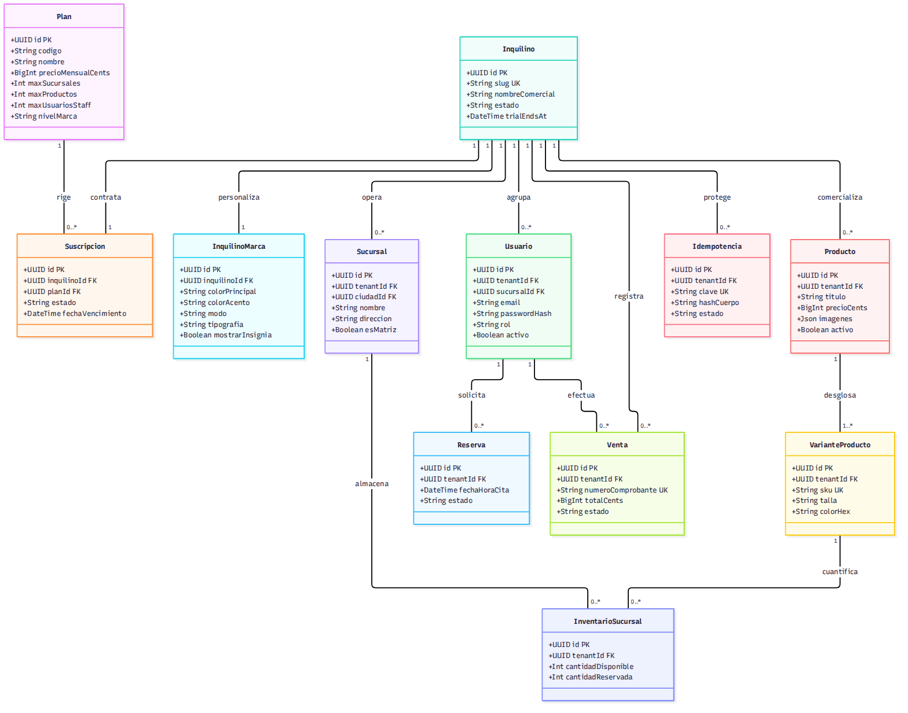

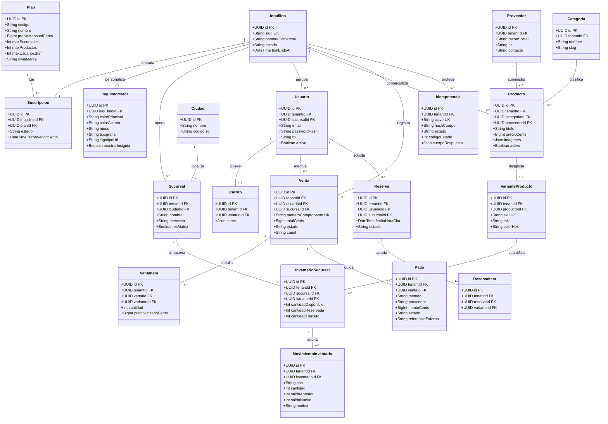

---

## 3.2. Diagramas de Robustez (BCE)

Siguiendo el estándar de la metodología ICONIX, el **Análisis de Robustez** actúa como puente dinámico entre los casos de uso esenciales y el diseño detallado. Cada diagrama clasifica los elementos en tres estereotipos formales:
- `<<boundary>>`: Interfaces de usuario web (PWA), móviles nativas (Expo) o pasarelas externas.
- `<<control>>`: Orquestadores de servicios de frontend (PWA Store/Hooks) y controladores de backend NestJS encargados de aplicar validaciones y reglas de negocio.
- `<<entity>>`: Almacenes de persistencia local (IndexedDB / SQLite) y tablas de la base de datos central PostgreSQL.

---

### CU01: Aprovisionar Tienda y Workspace SaaS

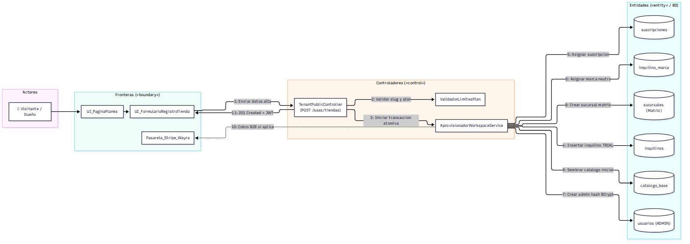

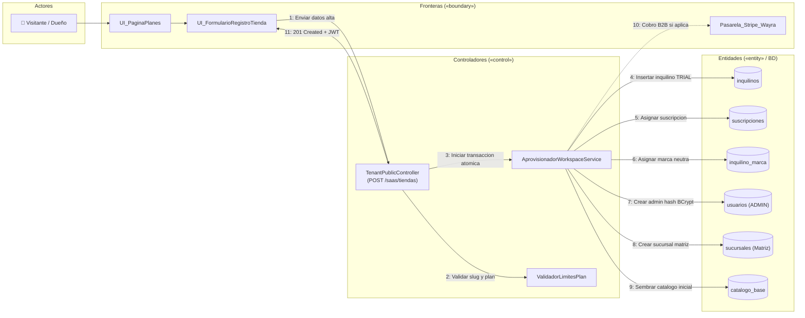

---

### CU03: Personalizar Identidad Visual de Boutique (WCAG 2.1)

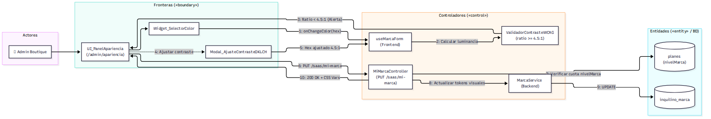

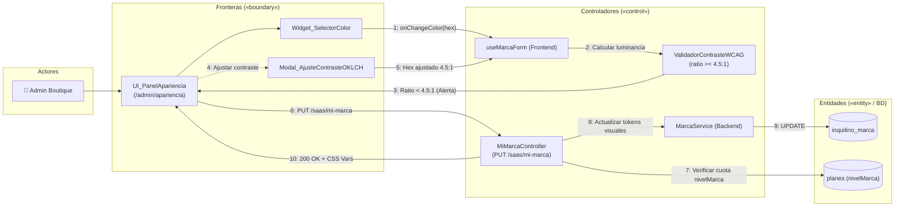

---

### CU10: Operar en Modo Desconectado con Sincronización Segura

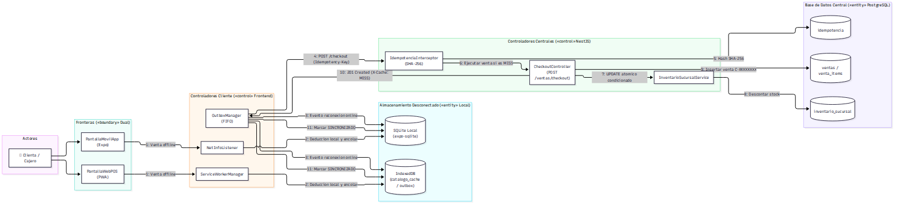

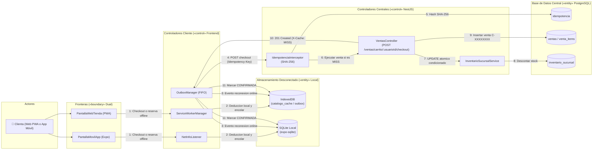

---

### CU11: Resolver Conflicto de Concurrencia de Stock (`stock = 1`)

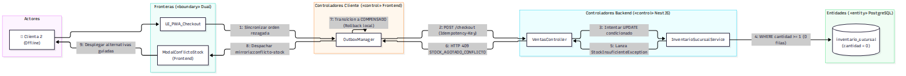

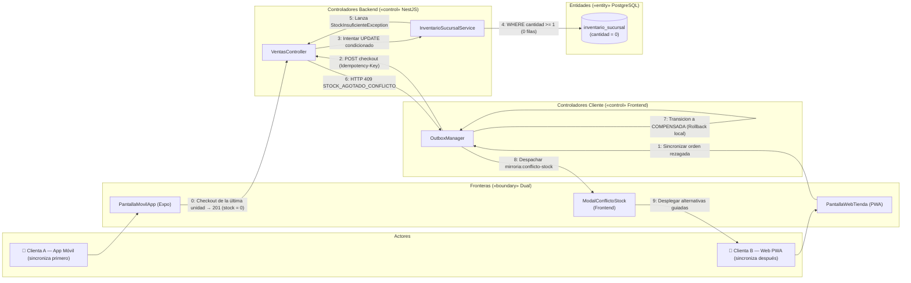

---

## 3.3. Diagramas de Secuencia UML 2.5

Los diagramas de secuencia mantienen **isomorfismo estricto** con las líneas de vida identificadas en el análisis de robustez, modelando los mensajes HTTP, códigos de estado, parámetros de cabecera y bifurcaciones transaccionales.

---

### Secuencia CU01: Aprovisionamiento Atómico SaaS

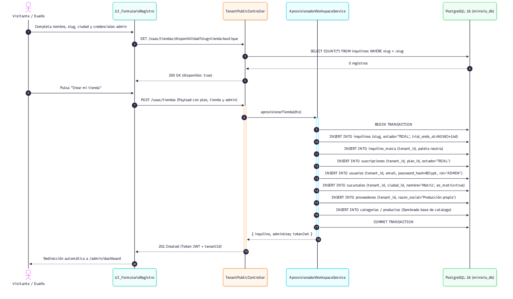

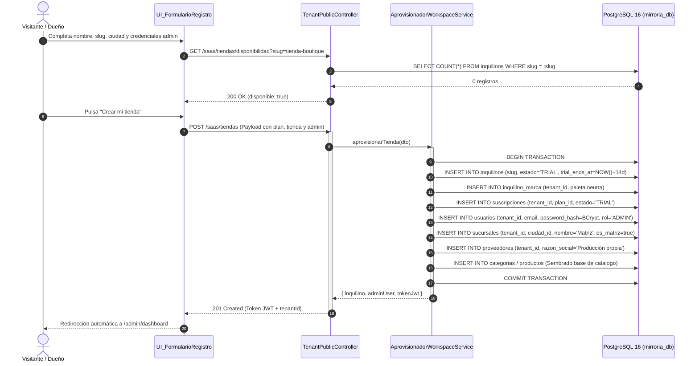

---

### Secuencia CU10: Operación Offline, Outbox e Idempotencia

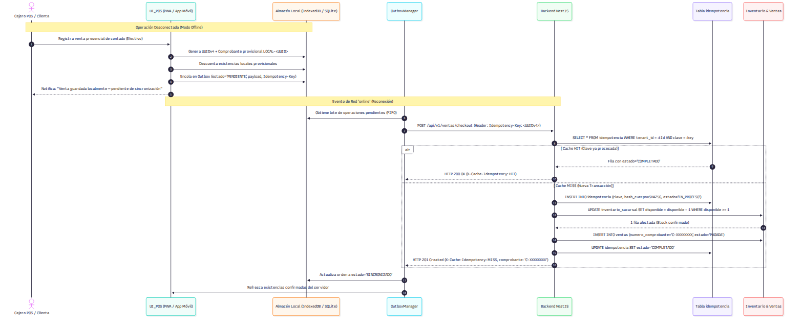

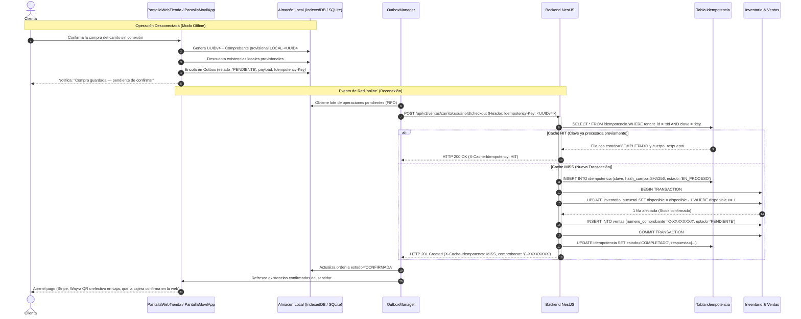

---

### Secuencia CU11: Conflicto Concurrente `stock = 1` y Compensación

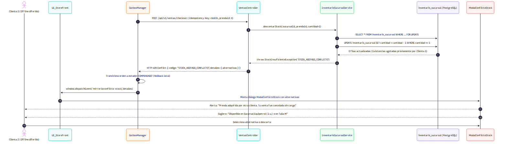

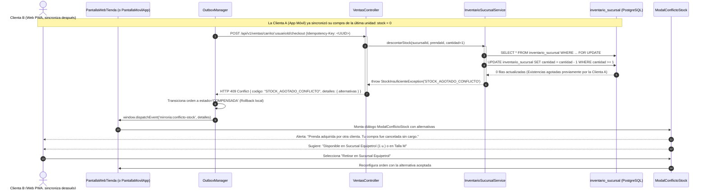

---

### Secuencia CU16: Inferencia de Machine Learning con Fallback Heurístico

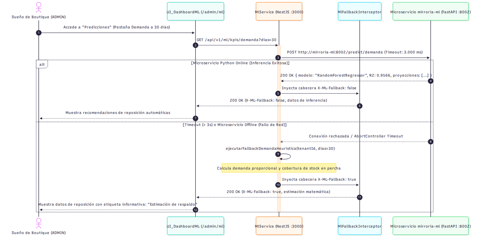

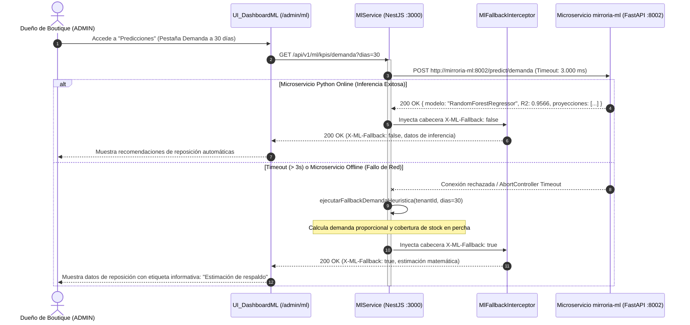

---

## 3.4. Diagrama de Clases de Análisis y Diseño UML

A continuación se modela la arquitectura de diseño estructurada en capas (`Boundary`, `Control` y `Entity`) para los casos de uso nucleares:

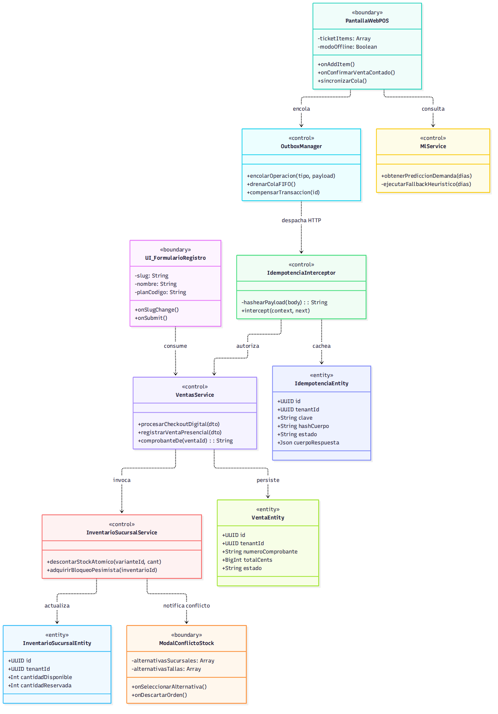

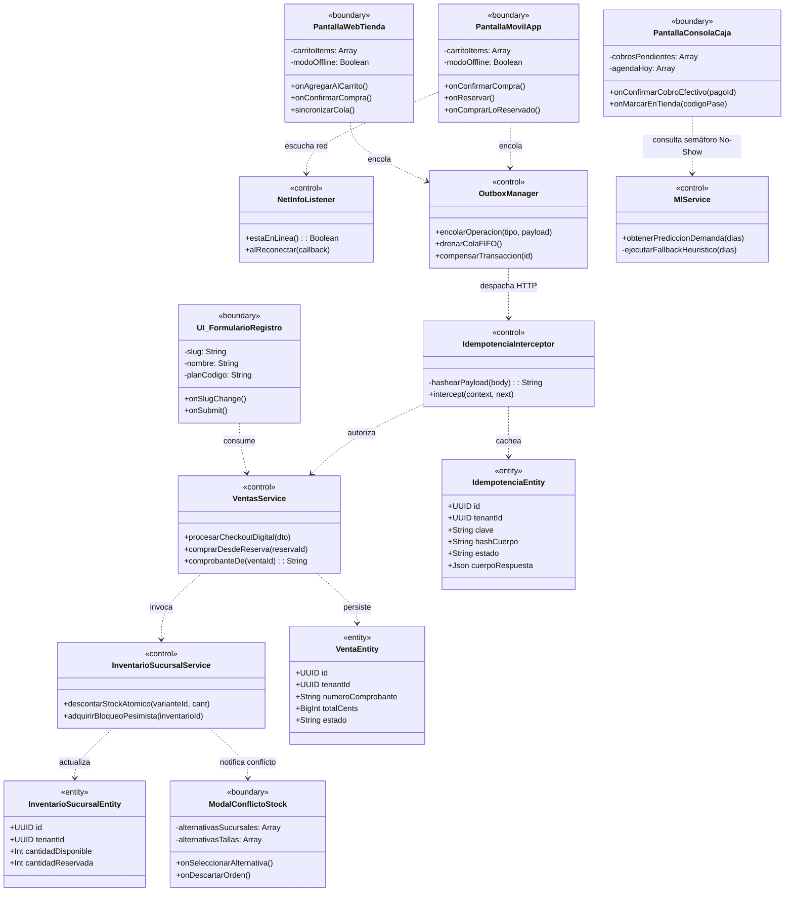

---

## 3.5. Diseño de la Base de Datos Relacional (PostgreSQL 16)

La base de datos relacional compartida (`mirroria_db`) se compone de **30 tablas normalizadas**, donde todas las entidades transaccionales y de negocio implementan `tenant_id: UUID NOT NULL` para aislamiento multi-tenant.

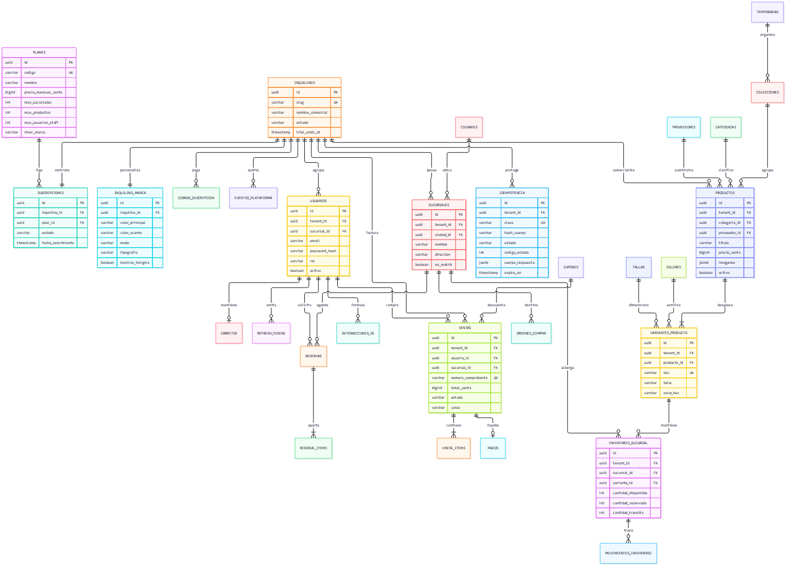

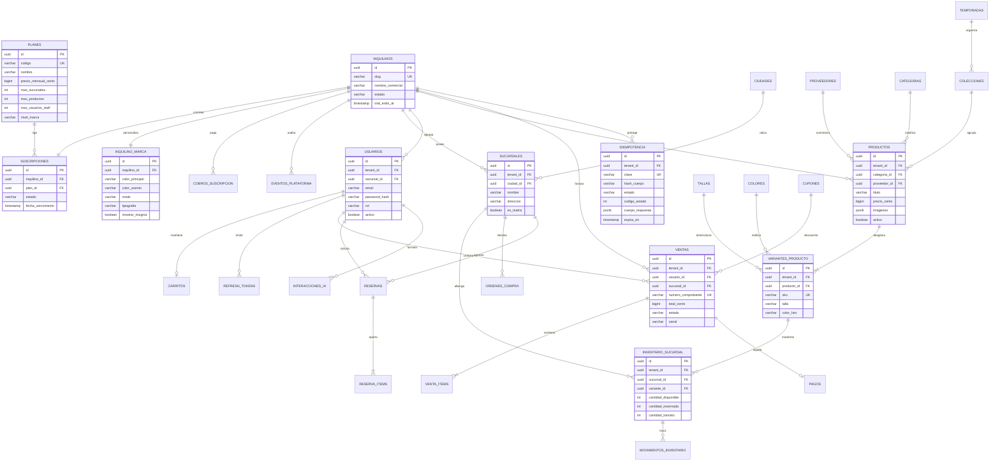

---

## 3.6. Diseño de Interfaces de Usuario

Siguiendo el principio de **alta fidelidad y correspondencia con el código**, las interfaces se articulan en tres mundos funcionales claros:

1. **Consola Global de la Plataforma MirrorIA (`/plataforma/*`):**
   - Dashboard directivo con indicadores agregados de MRR, ARR, Churn Rate y volumen transaccionado (GMV).
   - Tabla administrativa de inquilinos con conmutador de estado (Activa / Suspendida), selector de plan comercial y botón de restablecimiento de marca de oficio.
2. **Tienda Web Pública y Vitrina Omnicanal (`/t/:slug/*`):**
   - Inyección dinámica de tokens de diseño en `:root` (logotipo, tipografías, radio de curvatura en botones y colores).
   - Ficha técnica interactiva de prendas con selector de variantes SKU, consulta de existencias por sucursal física e integración con el **Probador Virtual por IA** (Decart `lucy-vton-3.5`).
   - Carrito de compras persistente (`jsonb`) con tope de 3 unidades por variante y flujo de checkout con validación de cupones y pasarelas de pago (Stripe Checkout y Wayra QR dinámico).
3. **Panel Administrativo de la Tienda (`/admin/*`, solo web; sin punto de venta):**
   - **Personalización de Marca (`/admin/apariencia`):** Paleta interactiva con indicador visual accesible **WCAG 2.1** (alerta ámbar si el ratio es $< 4.5:1$ y botón de ajuste automático en espacio OKLCH).
   - **Consola Ejecutiva de BI (`/admin/dashboard` para ADMIN):** Resumen de ingresos netos con deltas simétricos, ticket promedio, rotación de inventario, tasa de conversión y gráficos de tendencia Recharts.
   - **Consola de Caja (`/admin/dashboard` y `/admin/cobros` para Cajera y Encargado):** Corte diario local en `America/La_Paz`, cobros en efectivo pendientes de verificar (la cajera es el único rol que confirma dinero), alertas visuales de existencias críticas ($\le 2$ unidades) o agotadas, y agenda de citas de probador con llegada a tienda en un clic buscando el Pase de Tienda por su código.
   - **Operativa Offline de la clienta (PWA):** Banner persistente `⚡ Sin conexión — operando con datos locales`, checkout y reservas encolados como "Pendiente de confirmar" y diálogo interactivo `ModalConflictoStock` con sugerencia guiada de alternativas.
   - **Consola de Predicciones y Machine Learning (`/admin/ml`):** Tarjetas ejecutivas en lenguaje de negocio para reposición a 30 días, semáforo de riesgo de inasistencia (*no-show*), segmentación RFM y panel lateral `FichaTecnicaSheet` con el rigor científico formal ($N=10.000$, `seed=42`).
   - **Reportes con IA y Excel (`/admin/reportes`):** Asistente conversacional en lenguaje natural, tabla dinámica interactiva con repivoteo en vivo y botón de descarga directa de balances contables a formato nativo `.xlsx` (`exceljs`).
4. **App Móvil de la Clienta (`mirroria-mobile/`, Expo; solo clienta y visitante):**
   - Selector de tienda con la marca de la plataforma; luego toda la app se pinta con la marca de la tienda elegida (colores, logo, modo claro u oscuro).
   - Pestañas **Vitrina · Probador · Carrito · Mis cosas**: vitrina offline desde el espejo SQLite con stock por sucursal, escaneo de la etiqueta de una prenda en la tienda física para abrir su ficha, carrito y checkout encolables sin red, pagos (Wayra QR, Stripe, efectivo en caja), reservas con **Pase de Tienda** (QR y código `#XXXXXXXX` que la cajera busca en la web) y **"Comprar lo que reservé"**.
   - Probador con IA (Decart) reservado como "Próximamente" hasta el *development build*.
   - El personal (`ADMIN`, `ENCARGADO_SUCURSAL`, `CAJERO`) no tiene app móvil.
